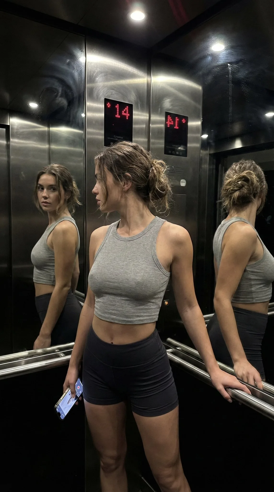

# babydoll — by @bananababydoll

[← Back to Community Examples](../../EXAMPLES.md) · Category: Photography · Model: `Nano Banana`

<a href="https://x.com/bananababydoll/status/2008782401510494539"></a>

Source: **[@bananababydoll on X](https://x.com/bananababydoll/status/2008782401510494539)** · Creator: [babydoll](https://x.com/bananababydoll)

## Prompt

```text
{
  "meta": {
    "aspect_ratio": "9:16",
    "quality": "ultra_photorealistic",
    "resolution": "8k",
    "camera": "iPhone front camera",
    "lens": "24mm",
    "style": "raw iPhone mirror realism, zero smoothing, heavy reflections, subtle grain, imperfect exposure"
  },

  "scene": {
    "location": "luxury apartment elevator",
    "environment": [
      "mirror walls on three sides",
      "brushed stainless steel panels",
      "glass-like reflection layering (multiple reflections of body)",
      "LED ceiling strip lights",
      "digital floor number glowing red",
      "slight fingerprints and smudges on mirror"
    ],
    "time": "late night",
    "atmosphere": "private tension in a public box, quiet, charged, intimate"
  },

  "lighting": {
    "type": "mixed elevator lighting",
    "sources": [
      "cool white overhead LEDs",
      "warm spill from control panel lights"
    ],
    "effect": [
      "high contrast highlights on hips and thighs",
      "specular reflections multiplying curves in mirrors",
      "face partially lit, partially disappearing in reflections",
      "real iPhone low-light noise in shadows"
    ]
  },

  "camera_perspective": {
    "pov": "mirror selfie",
    "angle": "slightly low and close",
    "framing": "upper thighs to head",
    "distance": "arm-length",
    "imperfections": [
      "phone edge visible in reflection",
      "finger slightly covering lens corner",
      "minor motion blur from breathing"
    ]
  },

  "subject": {
    "gender": "female",
    "ethnicity": "light european / mediterranean mix",
    "vibe": "young adult, controlled confidence, quietly provocative",

    "body": {
      "type": "fit-curvy",
      "waist": "tight and defined",
      "hips": "round and visually repeated by reflections",
      "thighs": "thick, softly compressed",
      "chest": "full and natural, secondary focus"
    },

    "skin": {
      "tone": "warm fair",
      "texture": "real skin texture, slight sheen, no blur"
    },

    "hair": {
      "color": "dark blonde",
      "style": "loose, slightly messy",
      "details": "a few strands stuck to lips and cheek"
    },

    "face": {
      "expression": "neutral with soft half-smirk",
      "eyes": "focused on phone screen",
      "makeup": "minimal, glossy lips catching light"
    },

    "outfit": {
      "top": {
        "type": "tight cropped tank top",
        "color": "soft grey",
        "fit": "hugging chest naturally, no bra",
        "details": "fabric stretched slightly, fine rib texture visible"
      },
      "bottom": {
        "type": "ultra-short micro biker shorts",
        "length": "barely covering upper thighs",
        "material": "thin matte spandex",
        "fit": "painted-on tight, amplified by mirror repetition",
        "details": [
          "fabric tension visible at hips",
          "slight ride-up at inner thighs",
          "clean, logo-free"
        ]
      },
      "shoes": {
        "type": "clean white sneakers",
        "reflection": "duplicated multiple times in mirrors"
      }
    },

    "pose": {
      "stance": "standing close to mirror",
      "hips": "shifted strongly to one side",
      "legs": "one knee bent inward",
      "upper_body": "shoulders relaxed, torso angled",
      "arms": {
        "phone_hand": "holding phone low",
        "free_hand": "resting lightly on upper thigh"
      },
      "movement": "still moment that feels like a pause, not a pose"
    }
  },

  "mood_keywords": [
    "mirror multiplication",
    "late night tension",
    "quiet confidence",
    "timeline stopper"
  ]
}
```

## Try it

Paste the prompt into **[vinano.ai](https://vinano.ai?utm_source=github&utm_medium=readme&utm_campaign=awesome-image-video-prompts-updating&utm_content=x-page-try)** to generate your own version.

> The image and prompt belong to @bananababydoll ([original post](https://x.com/bananababydoll/status/2008782401510494539)) and are shown here with credit for reference. Creators can ask for changes or removal by opening an issue.
