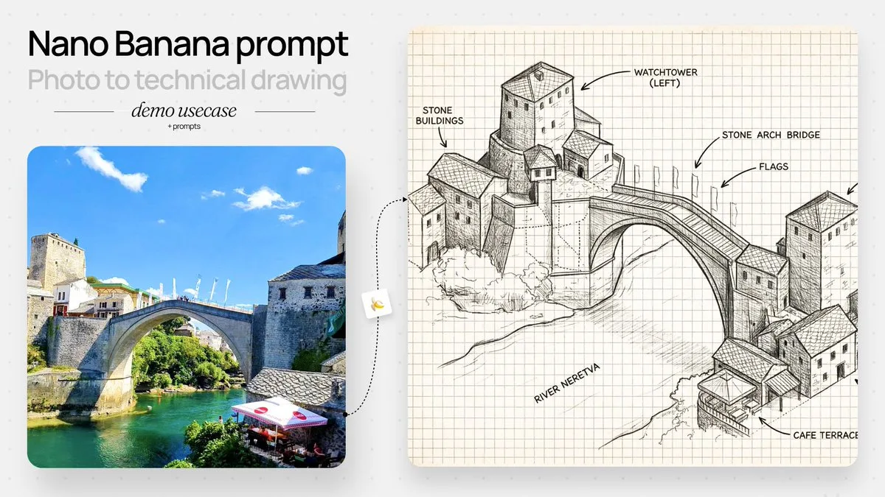

# AmirMušić — by @AmirMushich

[← Back to Examples from X](../../EXAMPLES.md) · Category: Illustration & 3D · Model: `Nano Banana`

<a href="https://x.com/AmirMushich/status/2011441977447911691"></a>

Original post: **[@AmirMushich on X](https://x.com/AmirMushich/status/2011441977447911691)** · Creator: [AmirMušić](https://x.com/AmirMushich)

## Prompt

```text
[Create a hand drawn isometric schematic diagram of this street]
```

## Try it

Paste the prompt into **[vinano.ai](https://vinano.ai?utm_source=github&utm_medium=readme&utm_campaign=awesome-image-video-prompts-updating&utm_content=x-page-try)** to generate your own version.

> The image and prompt belong to [@AmirMushich](https://x.com/AmirMushich) and are shown here with credit for reference. Creators can ask for changes or removal by opening an issue.
