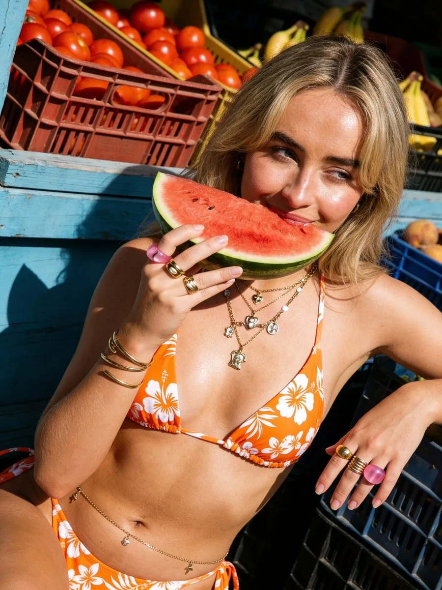

# LexiPrompt — by @Artist04048661

[← Back to Examples from X](../../EXAMPLES.md) · Category: Photography · Model: `Nano Banana`

<a href="https://x.com/Artist04048661/status/2029294271879168502"></a>

Original post: **[@Artist04048661 on X](https://x.com/Artist04048661/status/2029294271879168502)** · Creator: [LexiPrompt](https://x.com/Artist04048661)

## Prompt

```text
{
  "image_generation_prompt": {
    "subject": {
      "description": "Young woman with a strong resemblance to Sabrina Carpenter.",
      "hair": "Middle-parted, straight, and smooth texture with soft layers framing the face; natural physics as it rests over the shoulders.",
      "face": "Enigmatic expression with a subtle gaze, sun-kissed dewy skin texture, visible fine pores, and a light flush on the cheeks.",
      "body": "Slender physique with a tanned skin tone, showing realistic skin grain and soft highlights on the midriff."
    },
    "attire": {
      "clothing": "A vibrant orange string bikini with a white tropical floral print; the fabric has a slight sheen and thin spaghetti straps that tie at the neck and hips.",
      "style": "Bohemian Summer / Coastal Chic."
    },
    "styling_and_accessories": {
      "jewelry": [
        "Layered gold necklaces with various eclectic charms and pendants",
        "Multiple gold statement rings on several fingers",
        "A chunky translucent pink ring",
        "Sculptural gold wrap-around bracelets on both wrists",
        "A delicate gold belly chain resting across the waist"
      ]
    },
    "environment": {
      "setting": "A rustic outdoor fruit market stall featuring weathered blue wooden structures.",
      "background": "Stacked plastic crates filled with produce including ripe red tomatoes, bunches of yellow bananas, and various shadowed market goods.",
      "water": "None"
    },
    "pose": {
      "posture": "Seated on the ground, leaning slightly forward with a playful and relaxed demeanor.",
      "arms": "One hand is holding a large slice of watermelon up to her face, while the other arm is extended outward, resting against the blue stall structure.",
      "angle": "Eye-level shot with a slight tilt."
    },
    "lighting_and_mood": {
      "lighting": "Bright, direct natural sunlight creating high-contrast shadows and vivid highlights.",
      "mood": "Vibrant, sun-drenched, and candidly cinematic.",
      "colors": "A primary palette of saturated watermelon red, cobalt blue, and sun-ripened orange, grounded by earthy grey gravel."
    },
    "camera_and_technical": {
      "style": "Ultra Photorealistic, RAW photo.",
      "lens": "35mm wide-angle prime.",
      "aperture": "f/4.0 for a balance of sharp subject detail and environmental context.",
      "quality_tags": [
        "8k resolution",
        "highly detailed",
        "volumetric lighting",
        "ray tracing reflections",
        "hyper-realistic texture",
        "Hasselblad photography"
      ]
    }
  }
}
```

## Try it

Paste the prompt into **[vinano.ai](https://vinano.ai?utm_source=github&utm_medium=readme&utm_campaign=awesome-image-video-prompts-updating&utm_content=x-page-try)** to generate your own version.

> The image and prompt belong to [@Artist04048661](https://x.com/Artist04048661) and are shown here with credit for reference. Creators can ask for changes or removal by opening an issue.
