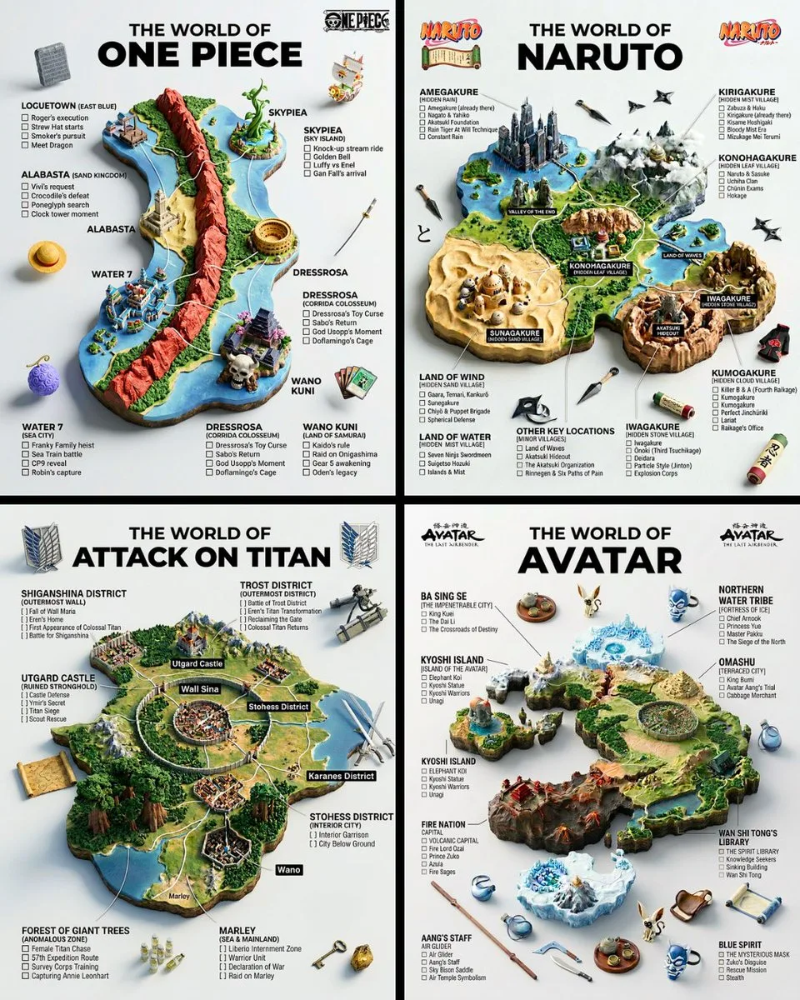

# TechieSA — by @TechieBySA

[← Back to Examples from X](../../EXAMPLES.md) · Category: Illustration & 3D · Model: `Nano Banana`

<a href="https://x.com/TechieBySA/status/2045107949639455223"></a>

Original post: **[@TechieBySA on X](https://x.com/TechieBySA/status/2045107949639455223)** · Creator: [TechieSA](https://x.com/TechieBySA)

## Prompt

```text
A hyper-realistic 3D world guide infographic poster for [SHOW]. The fictional world of [SHOW] is rendered as a raised, textured terrain map floating on a clean light gray surface — the map shape and landscape must reflect the actual geography and visual aesthetic of [SHOW] (fantasy kingdoms, post-apocalyptic cities, island archipelagos, ninja villages etc). Iconic locations from [SHOW] are placed as miniature 3D sculpted models at their correct canonical positions across the map — each one highly detailed, photorealistic and instantly recognizable to fans. Roads or paths connect key locations as white lines across the terrain. Around the map, floating 3D decorative props and iconic items from [SHOW] are scattered on the light gray surface. The official logo of [SHOW] is shown in the upper right corner. Each major location has a bold black label on the map, and beside the map, each location has a neat checklist of its most iconic characters or moments associated with that place, in clean sans-serif typography. A large bold title at the top reads: “THE WORLD OF SHOW” in black uppercase typography with [SHOW] in heavy bold. The overall aesthetic is premium editorial — soft studio lighting, photorealistic 3D render, white/light gray background, clean layout, 4:5 aspect ratio.
```

## Try it

Paste the prompt into **[vinano.ai](https://vinano.ai?utm_source=github&utm_medium=readme&utm_campaign=awesome-image-video-prompts-updating&utm_content=x-page-try)** to generate your own version.

> The image and prompt belong to [@TechieBySA](https://x.com/TechieBySA) and are shown here with credit for reference. Creators can ask for changes or removal by opening an issue.
