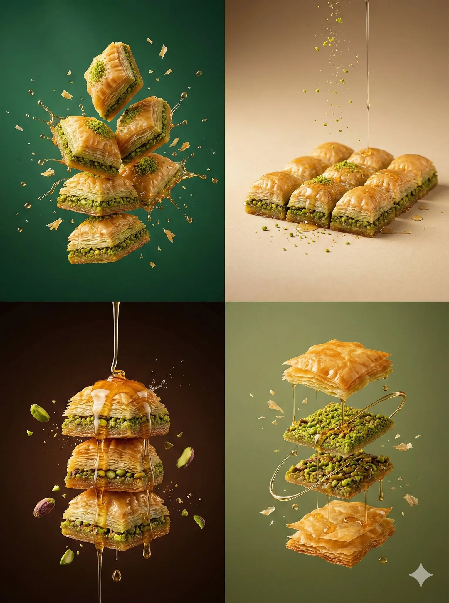

# Kaan — by @kaanakz

[← Back to Examples from X](../../EXAMPLES.md) · Category: Food & Drink · Model: `Nano Banana`

<a href="https://x.com/kaanakz/status/2009204329236828239"></a>

Original post: **[@kaanakz on X](https://x.com/kaanakz/status/2009204329236828239)** · Creator: [Kaan](https://x.com/kaanakz)

## Prompt

```text
{
  "resolution": "8K UHD",
  "aspect_ratio": "3:4",
  "image_style": "hyper-realistic commercial dessert photography",
  "global_settings": {
    "quality": "Ultra-high detail, razor-sharp focus, luxury dessert clarity",
    "lighting": "Controlled studio lighting emphasizing texture, layers, and syrup highlights",
    "motion": "Frozen mid-air elements with subtle gravity realism",
    "background_style": "Solid or smooth gradient background, color varies per module",
    "camera": "High-speed photography look, shallow to medium depth of field",
    "post_processing": "Rich contrast, warm tones, natural shine, no artificial glow"
  },
  "modules": { "module_1_classic_baklava_stack_explosion": {
      "scene_description": "A dramatic stack of classic pistachio baklava with flying syrup droplets",
      "baklava": {
        "type": "Traditional pistachio baklava",
        "layers": "Ultra-thin phyllo layers clearly visible",
        "cut": "Diamond-shaped pieces",
        "position": "Stacked and floating mid-air"
      },
      "details": {
        "nuts": "Finely ground bright green pistachios between layers",
        "syrup": "Golden sugar syrup glistening on edges"
      },
      "motion_effects": {
        "syrup": "Small syrup droplets splashing outward",
        "crumbs": "Tiny phyllo flakes suspended in air"
      },
      "background": {
        "color": "Deep emerald green",
        "texture": "Smooth, seamless"
      }
    }, "module_2_minimal_baklava_plate_floating": {
      "scene_description": "Minimalist premium baklava presentation with controlled floating crumbs",
      "baklava": {
        "type": "Single-layer pistachio baklava pieces",
        "arrangement": "Neatly aligned rectangular cuts",
        "surface": "Glossy with light syrup sheen"
      },
      "accent_elements": {
        "nuts": "Crushed pistachio dust lightly floating",
        "syrup": "Thin syrup drizzle frozen mid-air"
      },
      "motion_effects": {
        "particles": "Subtle floating crumbs and nut dust"
      },
      "background": {
        "color": "Warm beige",
        "gradient": "Very soft tonal gradient"
      }
    }, "module_3_baklava_syrup_pour_drama": {
      "scene_description": "Cinematic syrup pour over baklava stack",
      "baklava": {
        "type": "Thick stacked baklava slices",
        "texture": "Highly detailed crispy layers"
      },
      "additional_elements": {
        "syrup": {
          "state": "Thick golden syrup pouring from above",
          "motion": "Frozen in elegant flowing strands"
        },
        "nuts": [
          "Whole pistachio kernels",
          "Crushed pistachio fragments"
        ]
      },
      "motion_effects": {
        "splashes": "Micro syrup splashes on impact points",
        "particles": "Floating nut fragments"
      },
      "background": {
        "color": "Dark chocolate brown",
        "tone": "High contrast, luxury feel"
      }
    }, "module_4_modern_baklava_floating_composition": {
      "scene_description": "Modern deconstructed baklava composition in mid-air",
      "elements": {
        "phyllo": "Crispy golden phyllo sheets floating separately",
        "nuts": "Pistachio layers suspended between sheets",
        "syrup": "Glossy syrup threads connecting elements"
      },
      "motion_effects": {
        "flakes": "Ultra-fine pastry flakes suspended",
        "drops": "Minimal syrup droplets"
      },
      "background": {
        "color": "Muted olive green",
        "texture": "Smooth, seamless"
      }
    }
  },
  "negative_prompt": [
    "text",
    "logos",
    "branding",
    "hands",
    "people",
    "utensils",
    "plates",
    "tables",
    "cartoon style",
    "excessive syrup pooling",
    "burnt pastry",
    "overexposure",
    "artificial glow",
    "low detail textures"
  ]
}
```

## Try it

Paste the prompt into **[vinano.ai](https://vinano.ai?utm_source=github&utm_medium=readme&utm_campaign=awesome-image-video-prompts-updating&utm_content=x-page-try)** to generate your own version.

> The image and prompt belong to [@kaanakz](https://x.com/kaanakz) and are shown here with credit for reference. Creators can ask for changes or removal by opening an issue.
