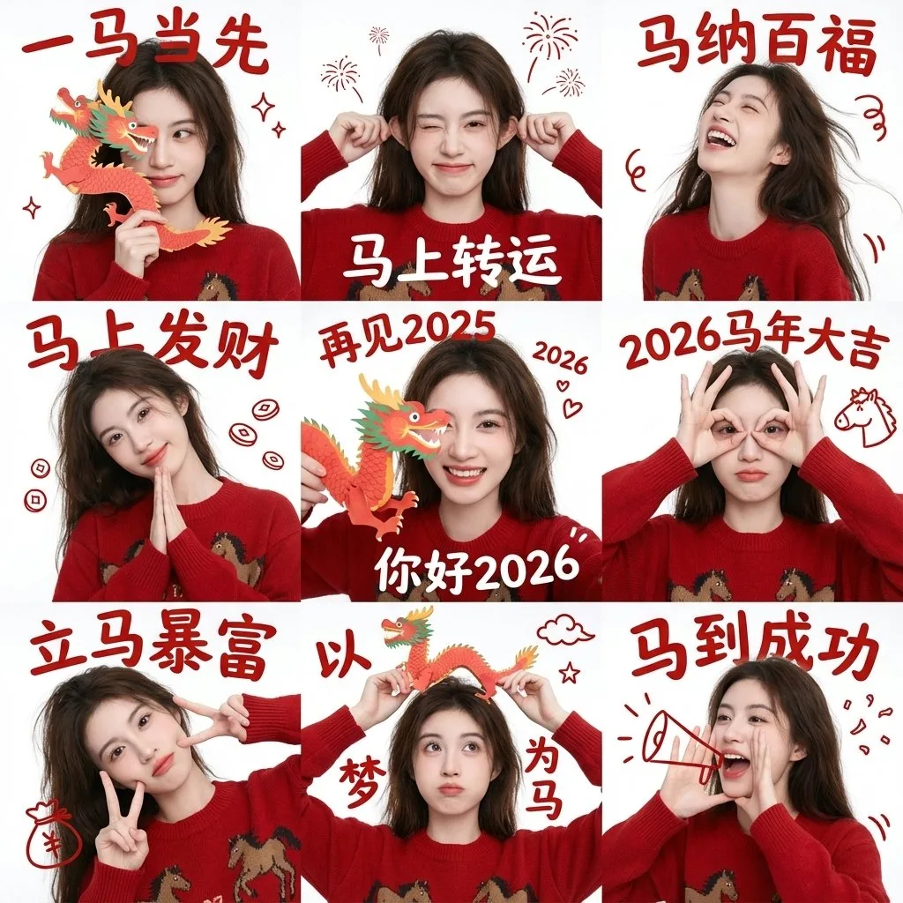

# 摆烂程序媛 — by @wanerfu

[← Back to Examples from X](../../EXAMPLES.md) · Category: Poster Design · Model: `Nano Banana`

<a href="https://x.com/wanerfu/status/2008421241091154115"></a>

Original post: **[@wanerfu on X](https://x.com/wanerfu/status/2008421241091154115)** · Creator: [摆烂程序媛](https://x.com/wanerfu)

## Prompt

```text
{
  "project_settings": {
    "task_type": "九宫格新年祝福肖像（男生版）",
    "aspect_ratio": "1:1",
    "grid_layout": "3x3",
    "batch_size": 1
  },

  "overall_style": {
    "整体风格": "极简新年祝福风",
    "视觉基调": "干净、温和、克制的节日感",
    "背景": "纯色白墙面，无装饰",
    "光线": "自然柔光，均匀无强阴影",
    "色彩重点": "中国红（服装 + 文字）"
  },

  "subject_base": {
    "人物一致性": "九宫格内为同一位人物",
    "人物类型": "亚洲男性",
    "性别气质": "干净、阳光、自然，不油腻",
    "发型": "黑色短发，自然蓬松，简洁利落",
    "服装": "红色针织毛衣或卫衣，简洁无图案",
    "妆容": "无明显妆感，真实自然肤质",
    "表情气质": "开心，克制的微笑，不夸张"
  },

  "pose_variations": {
    "grid_1": "食指竖于嘴前，轻松安静手势",
    "grid_2": "单手比 V 手势靠近脸部",
    "grid_3": "单手做 OK 或三指手势",
    "grid_4": "双手举起做轻松俏皮手势（不过度卖萌）",
    "grid_5": "单手张开遮住半边脸",
    "grid_6": "单手做电话手势靠近脸侧",
    "grid_7": "单手轻点脸颊或下巴",
    "grid_8": "单手托下巴，轻微思考姿势",
    "grid_9": "双手指向脸部或克制比心变体"
  },

  "text_overlays": {
    "字体风格": "传统中文新年书法字体",
    "文字颜色": "中国红",
    "年份颜色": "深蓝色",
    "文字位置": "每一格顶部居中",
    "文字结构": "四字祝福语 + 年份"
  },

  "text_content": [
    { "position": "grid_1", "text": "一帆风顺", "year": "2026" },
    { "position": "grid_2", "text": "双喜临门", "year": "2026" },
    { "position": "grid_3", "text": "三阳开泰", "year": "2026" },
    { "position": "grid_4", "text": "四季发财", "year": "2026" },
    { "position": "grid_5", "text": "五福临门", "year": "2026" },
    { "position": "grid_6", "text": "六六大顺", "year": "2026" },
    { "position": "grid_7", "text": "七星高照", "year": "2026" },
    { "position": "grid_8", "text": "八方来财", "year": "2026" },
    { "position": "grid_9", "text": "九九同心", "year": "2026" }
  ],

  "constraints": {
    "禁止项": [
      "不改变人物身份",
      "不夸张表情",
      "不女性化姿态",
      "不使用复杂背景",
      "不添加节日道具",
      "不风格化面部"
    ],
    "一致性要求": [
      "人物脸型五官保持完全一致",
      "服装颜色与材质一致",
      "拍摄角度与距离基本一致"
    ]
  },

  "use_cases": [
    "男生新年纪念照",
    "个人春节祝福九宫格",
    "社交平台头像矩阵",
    "品牌新年男生模板"
  ]
}
```

## Try it

Paste the prompt into **[vinano.ai](https://vinano.ai?utm_source=github&utm_medium=readme&utm_campaign=awesome-image-video-prompts-updating&utm_content=x-page-try)** to generate your own version.

> The image and prompt belong to [@wanerfu](https://x.com/wanerfu) and are shown here with credit for reference. Creators can ask for changes or removal by opening an issue.
