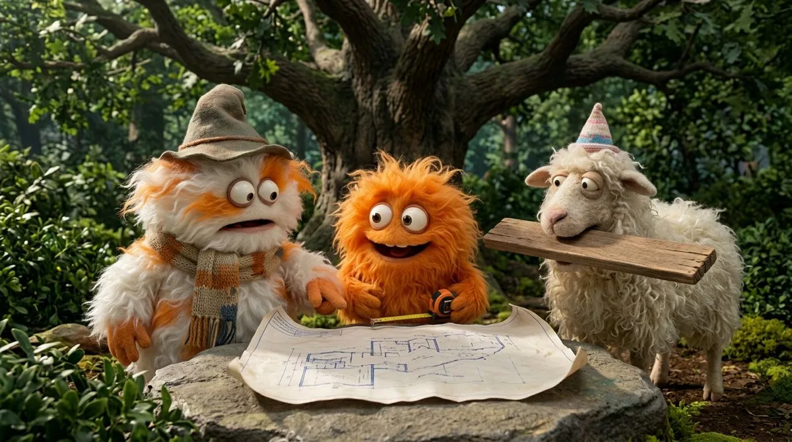

# Google AI — by @GoogleAI

[← Back to Community Examples](../../EXAMPLES.md) · Category: Illustration & 3D · Model: `Nano Banana`

<a href="https://x.com/GoogleAI/status/2027094912357761319"></a>

Source: **[@GoogleAI on X](https://x.com/GoogleAI/status/2027094912357761319)** · Creator: [Google AI](https://x.com/GoogleAI)

## Prompt

```text
Create a funny 4-part story featuring 3 fluffy creatures building a treehouse. The story has emotional highs and lows and ends in a happy moment. Maintain consistent identity across the 3 characters. Generate 4 images in 16:9 format, one at a time.
```

## Try it

Paste the prompt into **[vinano.ai](https://vinano.ai?utm_source=github&utm_medium=readme&utm_campaign=awesome-image-video-prompts-updating&utm_content=x-page-try)** to generate your own version.

> The image and prompt belong to @GoogleAI ([original post](https://x.com/GoogleAI/status/2027094912357761319)) and are shown here with credit for reference. Creators can ask for changes or removal by opening an issue.
