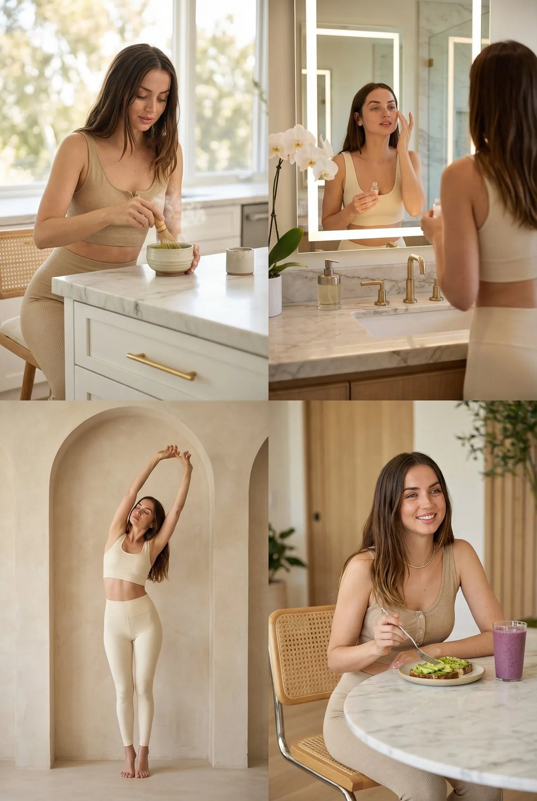

# Melisa♡ — by @xmliisu

[← Back to Community Examples](../../EXAMPLES.md) · Category: Photography · Model: `Nano Banana`

<a href="https://x.com/xmliisu/status/2008486850378293427"></a>

Source: **[@xmliisu on X](https://x.com/xmliisu/status/2008486850378293427)** · Creator: [Melisa♡](https://x.com/xmliisu)

## Prompt

```text
{
  "overall_theme": {
    "description": "A curated series of four ultra-photorealistic vignettes showcasing a luxurious, wellness-focused lifestyle.",
    "mood": "Calm, serene, balanced, sophisticated, peaceful, rejuvenating.",
    "style": "Minimalist, high-end, contemporary, clean aesthetic, aspirational."
  },
  "subject": {
    "description": "Young woman.",
    "appearance": {
      "hair": "Long, dark brown, wavy, natural texture.",
      "skin": "Clear, glowing, natural.",
      "makeup": "No-makeup makeup look, dewy finish.",
      "physique": "Fit, toned."
    },
    "expression": "Serene, composed, gently smiling, focused."
  },
  "wardrobe": {
    "outfit_base": "Matching ribbed beige/cream activewear set.",
    "variations": [
      "Sleeveless crop top and high-waisted leggings.",
      "Long-sleeve crop top and high-waisted leggings."
    ],
    "style": "Comfortable, stylish, high-quality fabric."
  },
  "environmental_details": {
    "lighting": {
      "type": "Natural daylight.",
      "quality": "Soft, diffused, warm, bright.",
      "source": "Large windows (implied or visible)."
    },
    "color_palette": {
      "dominant": ["Warm Beige", "Cream", "White", "Marble Grey"],
      "accents": ["Green (plants)", "Gold (fixtures, details)", "Natural Wood", "Soft Purple (smoothie)"]
    },
    "materials": ["White Marble", "Light Wood", "Stone", "Ceramic", "Glass", "Linen"]
  },
  "scenes": [
    {
      "location": "Modern Luxury Kitchen",
      "environment": "White marble island and countertops, white shaker cabinets, gold hardware, integrated wine fridge, large window.",
      "pose": "Standing at the island, body angled slightly, looking down.",
      "action": "Whisking a hot beverage in a small bowl.",
      "props": ["Ceramic bowl", "Wooden whisk", "Steam", "Mug with 'H'", "Wine fridge"]
    },
    {
      "location": "High-End Bathroom",
      "environment": "Large backlit mirror, white marble vanity, white walls, orchid plant.",
      "pose": "Standing facing the mirror, one hand applying product to face.",
      "action": "Applying skincare.",
      "props": ["Cotton pad", "Skincare bottle", "Lit Diptyque candle", "Whole coconut", "Glass jars"]
    },
    {
      "location": "Minimalist Wellness Space",
      "environment": "Textured beige walls with curved arches, stone water fountain, eucalyptus in a vase.",
      "pose": "Full-body stretch, arms extended overhead, head tilted back, eyes closed.",
      "action": "Stretching.",
      "props": ["Stone water feature", "Large perfume bottle", "Eucalyptus vase"]
    },
    {
      "location": "Bright Café Corner",
      "environment": "Round white marble table, cane chair, large window overlooking a street.",
      "pose": "Sitting at the table, smiling while eating, holding a fork.",
      "action": "Eating avocado toast.",
      "props": ["Avocado toast on plate", "Purple smoothie in glass", "Fork", "Assouline book", "Notebooks", "Small flowers"]
    }
  ],
  "camera_and_technical": {
    "type": "DSLR Photography",
    "style": "Editorial lifestyle",
    "lens": "Prime lens (e.g., 50mm or 85mm f/1.4)",
    "focus": "Sharp focus on the subject in each frame.",
    "depth_of_field": "Shallow, creating a soft, creamy bokeh in the background.",
    "resolution": "Ultra-high resolution, photorealistic textures.",
    "composition": "Four-panel grid collage."
  }
}
```

## Try it

Paste the prompt into **[vinano.ai](https://vinano.ai?utm_source=github&utm_medium=readme&utm_campaign=awesome-image-video-prompts-updating&utm_content=x-page-try)** to generate your own version.

> The image and prompt belong to @xmliisu ([original post](https://x.com/xmliisu/status/2008486850378293427)) and are shown here with credit for reference. Creators can ask for changes or removal by opening an issue.
