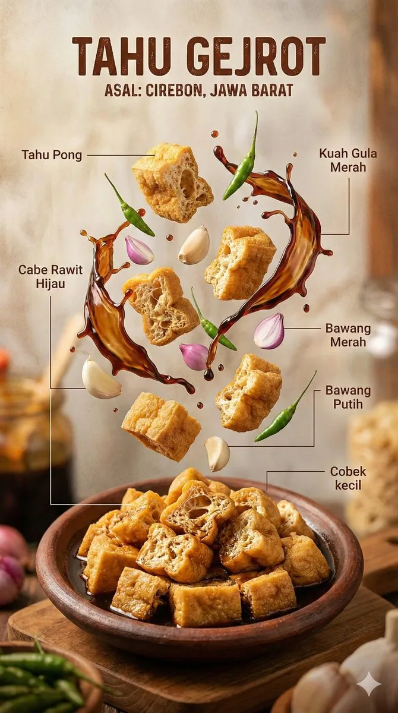

# Taaruk — by @Taaruk_

[← Back to Community Examples](../../EXAMPLES.md) · Category: Food & Drink · Model: `Nano Banana`

<a href="https://x.com/Taaruk_/status/2017865644365255078"></a>

Source: **[@Taaruk_ on X](https://x.com/Taaruk_/status/2017865644365255078)** · Creator: [Taaruk](https://x.com/Taaruk_)

## Prompt

```text
{
  "image_prompt": {
    "type": "Hyper-realistic food infographic",
    "subject": {
      "cuisine": "Indonesian",
      "base_element": "Traditional bowl with steaming hot dish at the bottom",
      "levitating_ingredients": [
        "Juicy meat",
        "Crispy tofu",
        "Glossy sauce splashes",
        "Fresh herbs",
        "Chilies",
        "Lime",
        "Garlic",
        "Fried shallots"
      ]
    },
    "composition": {
      "layout": "Clean vertical composition",
      "arrangement": "Realistic gravity-defying/floating elements",
      "background": "Rustic wooden surface",
      "visual_hierarchy": "Bowl anchored at bottom, ingredients rising vertically"
    },
    "graphic_design_elements": {
      "labels": "Clear Indonesian text",
      "lines": "Thin white pointing lines",
      "style": "Editorial infographic layout, professional food magazine style"
    },
    "lighting_and_mood": {
      "lighting": "Cinematic studio lighting",
      "color_palette": "Warm tones",
      "effects": "Dramatic steam, motion-frozen ingredients"
    },
    "technical_specs": {
      "camera_settings": "Shallow depth of field, sharp focus, DSLR look",
      "details": "Ultra-detailed textures",
      "resolution": "8K ultra-realistic"
    }
  }
}
```

## Try it

Paste the prompt into **[vinano.ai](https://vinano.ai?utm_source=github&utm_medium=readme&utm_campaign=awesome-image-video-prompts-updating&utm_content=x-page-try)** to generate your own version.

> The image and prompt belong to @Taaruk_ ([original post](https://x.com/Taaruk_/status/2017865644365255078)) and are shown here with credit for reference. Creators can ask for changes or removal by opening an issue.
