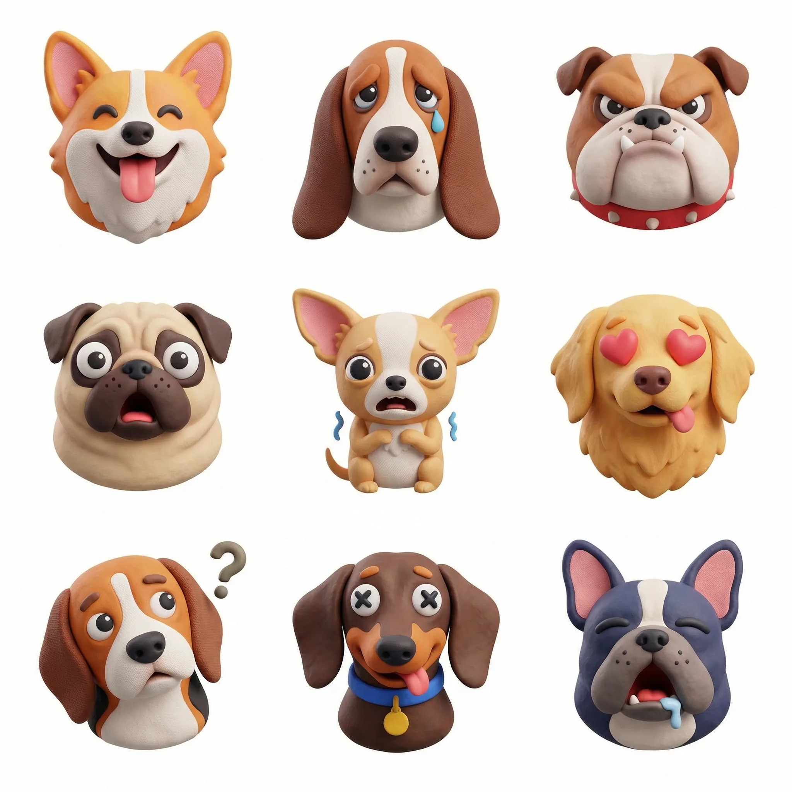

# Nano Banana Pro — by @NanoBanana

[← Back to Examples from X](../../EXAMPLES.md) · Category: Illustration & 3D · Model: `Nano Banana`

<a href="https://x.com/NanoBanana/status/2009660363227152653"></a>

Original post: **[@NanoBanana on X](https://x.com/NanoBanana/status/2009660363227152653)** · Creator: [Nano Banana Pro](https://x.com/NanoBanana)

## Prompt

```text
Create a collection of icons representing [a theme], they belong together as a single theme. Put them in a 3x3 grid. The background is white. Make the icons in a colorful and tactile 3D style. No text.

- dogs with different emotions
- bananas
- January
- the same cat in different emotions
```

## Try it

Paste the prompt into **[vinano.ai](https://vinano.ai?utm_source=github&utm_medium=readme&utm_campaign=awesome-image-video-prompts-updating&utm_content=x-page-try)** to generate your own version.

> The image and prompt belong to [@NanoBanana](https://x.com/NanoBanana) and are shown here with credit for reference. Creators can ask for changes or removal by opening an issue.
