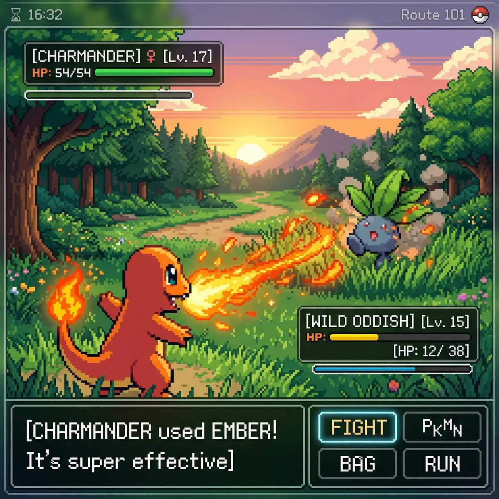

# proper — by @ProperPrompter

[← Back to Community Examples](../../EXAMPLES.md) · Category: Illustration & 3D · Model: `Nano Banana`

<a href="https://x.com/ProperPrompter/status/2027157212863631567"></a>

Source: **[@ProperPrompter on X](https://x.com/ProperPrompter/status/2027157212863631567)** · Creator: [proper](https://x.com/ProperPrompter)

## Prompt

```text
inspired by a classic pokemon gameboy screenshot but it's highly detailed beautiful pixel art, include cool effects from moves used, modern minimal ui
```

## Try it

Paste the prompt into **[vinano.ai](https://vinano.ai?utm_source=github&utm_medium=readme&utm_campaign=awesome-image-video-prompts-updating&utm_content=x-page-try)** to generate your own version.

> The image and prompt belong to @ProperPrompter ([original post](https://x.com/ProperPrompter/status/2027157212863631567)) and are shown here with credit for reference. Creators can ask for changes or removal by opening an issue.
