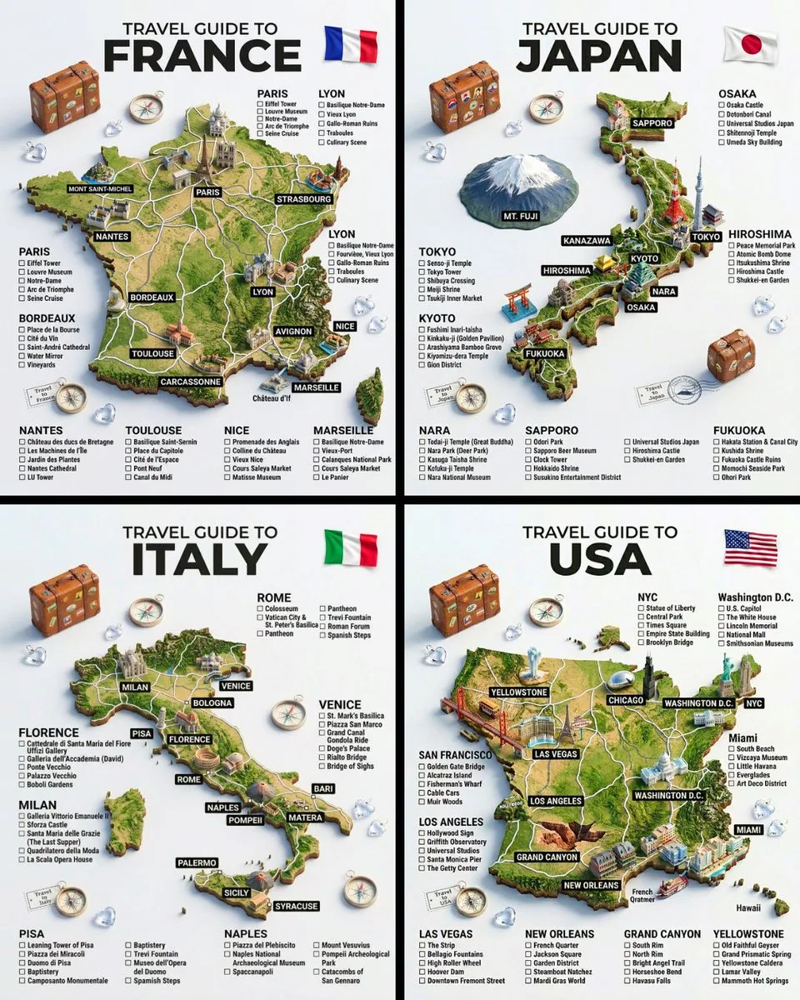

# TechieSA — by @TechieBySA

[← Back to Examples from X](../../EXAMPLES.md) · Category: Illustration & 3D · Model: `Nano Banana`

<a href="https://x.com/TechieBySA/status/2043047413770809708"></a>

Original post: **[@TechieBySA on X](https://x.com/TechieBySA/status/2043047413770809708)** · Creator: [TechieSA](https://x.com/TechieBySA)

## Prompt

```text
A hyper-realistic 3D travel guide infographic poster for [COUNTRY]. The country shape is rendered as a raised, textured terrain map floating on a clean light gray surface. Iconic landmarks are placed as miniature 3D sculpted models at their correct geographic locations across the map — each one highly detailed and photorealistic. Roads or railway lines connect key cities as white paths across the terrain. Around the map, floating 3D decorative props related to travel are scattered: a vintage leather suitcase with travel stickers, a compass rose, crystal heart charms, and a postage stamp seal reading “Travel to COUNTRY.” The national flag of [COUNTRY] is shown as a small realistic folded flag in the upper right corner. Each major city has a bold black label on the map, and beside the map, each city has a neat checklist of its top attractions in clean sans-serif typography. A large bold title at the top reads: “TRAVEL GUIDE TO “COUNTRY”” in black uppercase typography with the word [COUNTRY] in heavy bold. The overall aesthetic is premium editorial travel content — soft studio lighting, photorealistic 3D render, white/light gray background, clean layout.
```

## Try it

Paste the prompt into **[vinano.ai](https://vinano.ai?utm_source=github&utm_medium=readme&utm_campaign=awesome-image-video-prompts-updating&utm_content=x-page-try)** to generate your own version.

> The image and prompt belong to [@TechieBySA](https://x.com/TechieBySA) and are shown here with credit for reference. Creators can ask for changes or removal by opening an issue.
