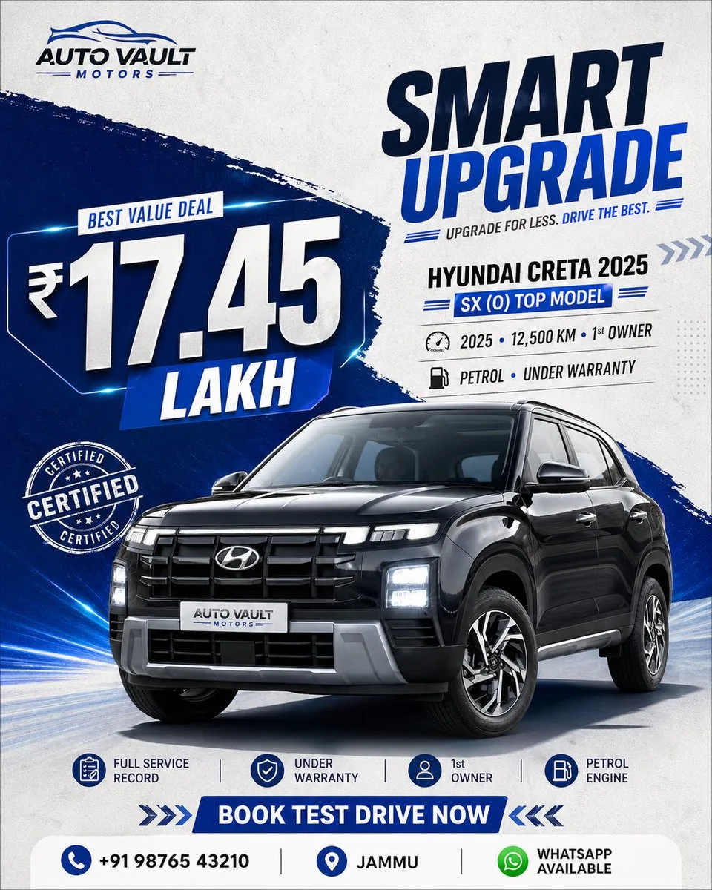

# ᴍᴜʀᴘʜʏ — by @Diplomeme

[← Back to Examples from X](../../EXAMPLES.md) · Category: Poster Design · Model: `GPT Image`

<a href="https://x.com/Diplomeme/status/2049019141093528045"></a>

Original post: **[@Diplomeme on X](https://x.com/Diplomeme/status/2049019141093528045)** · Creator: [ᴍᴜʀᴘʜʏ](https://x.com/Diplomeme)

## Prompt

```text
[BRAND NAME = AUTO VAULT MOTORS]
[CAR MODEL = HYUNDAI CRETA 2025 • SX (O) TOP MODEL]
[PRICE = ₹17.45 LAKH]
[KEY HIGHLIGHTS = 12,500 KM • 1st OWNER • PETROL • FULL SERVICE RECORD • UNDER WARRANTY]
[CONTACT = +91 98765 43210 • WHATSAPP AVAILABLE • JAMMU]

Act as a Social Media Art Director and Digital Collage Artist specializing in bold, youth-oriented automotive resale promotions for Instagram and digital campaigns.

PHASE 1: CONCEPTUAL FRAMEWORK
Create a high-conversion digital collage that positions this Creta as a premium smart buy.

This is not “used”.
This is “upgrade for less”.

Visual strategy:
- Blend premium SUV aspiration with deal urgency
- Controlled chaos with refined execution
- Price + car as dual hero

Aesthetic:
Clean chaos — less messy, more premium energy

PHASE 2: MODEL & PHOTOGRAPHY
- Subject: Hyundai Creta 2025 SX (O)
- Pose Energy: Front 3/4 angle, slightly turned, confident stance
- Hero Product: Full car body with emphasis on grill + DRLs

- Photography Style: Clean high-resolution cutout
- Camera Angle: Slight low angle (premium presence)
- Crop: Full car visible

- Optional Human Element:
  Subtle driver silhouette inside for realism

PHASE 3: COLOR BLOCKING FOUNDATION
- Primary Color Blob:
  Deep metallic blue (premium tone)

- Size:
  ~50% of composition

- Shape Style:
  Smooth torn-brush hybrid (refined, not aggressive)

- Texture:
  Light metallic grain (15%)

- Placement:
  Diagonal behind car (top-left → bottom-right flow)

PHASE 4: GRAPHIC ELEMENTS LAYER
- Price badge (bold, high contrast) — PRIMARY
- “CERTIFIED” stamp badge
- Minimal arrow accents pointing toward car
- Soft glow lines (premium touch)

Rules:
- Colors: Blue + white + subtle neon accent
- Placement: Corners, avoid cluttering car
- Scale: Price = largest graphic element

PHASE 5: TYPOGRAPHY INTEGRATION
- Logo:
  Top-left (clean, small)

- Headline:
  “SMART UPGRADE”

- Price (DOMINANT):
  “₹17.45 LAKH”

- Supporting Copy:
  “2025 • 12,500 KM • 1st OWNER”
  “PETROL • UNDER WARRANTY”

- CTA:
  “BOOK TEST DRIVE NOW”

- Type Treatment:
  Clean bold sans-serif, minimal rotation (2° max)

- Hierarchy:
  Price → Headline → Car name → Details → CTA → Logo

PHASE 6: TEXTURE & BACKGROUND
- Base:
  Light grey premium tone (RGB ~246)

- Texture:
  Subtle paper + metallic grain blend

- Rule:
  Very controlled — premium feel

PHASE 7: COMPOSITION RULES
- Layout:
  Car slightly right of center

- Breathing Room:
  20% clean space

- Layering:
  Background → Blob → Graphics → Car → Typography

- Focal Split:
  60% car + price  
  40% support elements

- Movement:
  Diagonal guiding eye → price → CTA

PHASE 8: BRAND INTELLIGENCE
Premium used dealer:
- Clean layout
- Strong trust signals
- Minimal chaos vs streetwear style

PHASE 9: SOCIAL MEDIA FOOTER
- Bottom strip (clean white)
- Content:
  📞 +91 98765 43210  
  📍 Jammu  
  💬 WhatsApp Available

- Layout:
  Minimal grid

TECHNICAL SPECS:
- 4:5 ratio (Instagram)
- 2400x3000px+
- sRGB
- High clarity (car ultra sharp)
- Controlled grain

- Style:
  Gen-Z collage × premium dealership aesthetic

FINAL OUTPUT MOOD:
Premium.
Trustworthy.
Urgent.
Smart purchase.
High conversion intent.
```

## Try it

Paste the prompt into **[vinano.ai](https://vinano.ai?utm_source=github&utm_medium=readme&utm_campaign=awesome-image-video-prompts-updating&utm_content=x-page-try)** to generate your own version.

> The image and prompt belong to [@Diplomeme](https://x.com/Diplomeme) and are shown here with credit for reference. Creators can ask for changes or removal by opening an issue.
