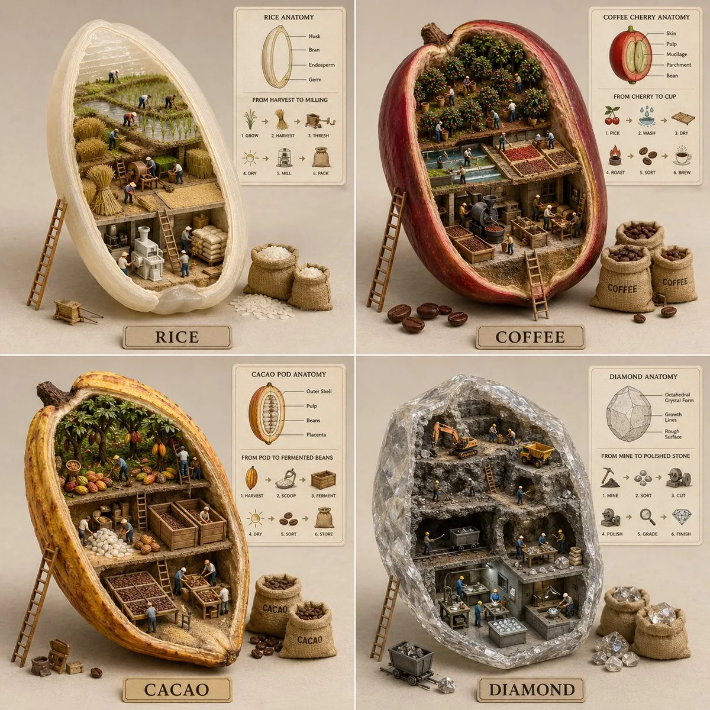

# Gadgetify — by @Gdgtify

[← Back to Examples from X](../../EXAMPLES.md) · Category: Illustration & 3D · Model: `GPT Image`

<a href="https://x.com/Gdgtify/status/2048964671852405035"></a>

Original post: **[@Gdgtify on X](https://x.com/Gdgtify/status/2048964671852405035)** · Creator: [Gadgetify](https://x.com/Gdgtify)

## Prompt

```text
2x2 grid, do this for 4 common ingredients (like rice, diamond): render_target = ( giant_sliced_open_[product_name] * 2.0 ) + ( inferred_harvesting_and_processing_diorama_inside * 1.8 ) + ( miniature_1:87_scale_plastic_workers * 1.5 ) + ( floating_2d_anatomy_diagram_box_top_right * 2.0 ) + ( tiny_ladders_and_sacks_exterior * 1.0 ) + ( clean_beige_studio_background * 1.2 ) - ( life_size_humans / 2.0 ) - ( cluttered_background / 2.0 ) - ( 3d_rendered_ui_box )
```

## Try it

Paste the prompt into **[vinano.ai](https://vinano.ai?utm_source=github&utm_medium=readme&utm_campaign=awesome-image-video-prompts-updating&utm_content=x-page-try)** to generate your own version.

> The image and prompt belong to [@Gdgtify](https://x.com/Gdgtify) and are shown here with credit for reference. Creators can ask for changes or removal by opening an issue.
