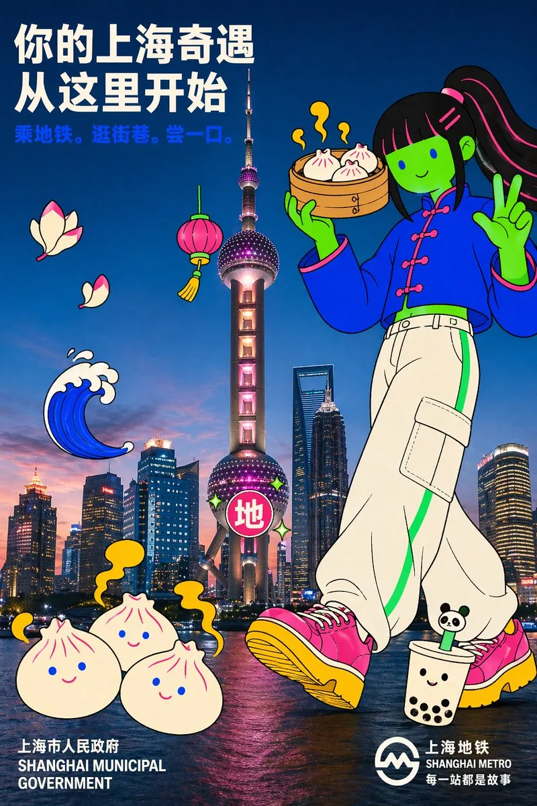

# Vigo Zhao — by @VigoCreativeAI

[← Back to Community Examples](../../EXAMPLES.md) · Category: Poster Design · Model: `GPT Image`

<a href="https://x.com/VigoCreativeAI/status/2047944141015802341"></a>

Source: **[@VigoCreativeAI on X](https://x.com/VigoCreativeAI/status/2047944141015802341)** · Creator: [Vigo Zhao](https://x.com/VigoCreativeAI)

## Prompt

```text
{
  "style_id": "photo-flat-doodle-campaign-poster",
  "style_name": "Photo × Flat-Doodle Campaign Poster",
  "version": "1.0",
  "aspect_ratio": "2:3",
  "reference": "Shanghai edition — derived from TfL 'Your London Adventure Starts Here'",

  "variables": {
    "scene": {
      "city": "上海 Shanghai",
      "landmark_photo": {
        "subject": "Oriental Pearl Tower with Lujiazui skyline in the background, viewed from across the Huangpu River",
        "angle": "low-angle hero shot, Pearl Tower centered and vertical, the two pink spheres clearly visible",
        "lighting": "early evening blue hour, city lights just starting to glow, sky still holding daylight",
        "treatment": "unretouched realistic photograph, natural steel + concrete + river reflection, no filter"
      },
      "background_sky": "deep teal-to-indigo gradient sky with a subtle warm glow at the horizon, upper 40% of canvas kept open for headline"
    },

    "hero_character": {
      "enabled": true,
      "scale": "giant — roughly 1.2× tower height, standing on the right, body extends beyond canvas",
      "pose": "holding a cartoon xiaolongbao steamer basket up to eye level with one hand, the other hand doing a casual wave, one foot slightly lifted mid-step",
      "skin_tone": "flat neon-green (non-realistic)",
      "face": "minimal — single curved smile, no nose, small cobalt-blue round eyes like dots",
      "hair": "long straight black-with-hot-pink-streaks hair, high ponytail swinging to one side, short blunt bangs",
      "outfit": {
        "top": "oversized cobalt-blue modern qipao-inspired jacket with a stand collar, hot-pink frog-button closures, cropped length",
        "bottom": "off-white baggy cargo pants with a neon-green side stripe and oversized pockets",
        "shoes": "chunky pink-and-yellow platform sneakers"
      },
      "accessory": "bamboo-style cartoon steamer basket with three xiaolongbao peeking out, tiny yellow steam swirls drawn above",
      "linework": "thin consistent black outline on qipao collar, frog buttons, ponytail strands, and steamer weave"
    },

    "doodle_props": [
      {
        "id": "giant_xiaolongbao_cloud",
        "shape": "three oversized cartoon soup dumplings floating together with exaggerated steam swirls",
        "colors": ["off-white dumpling skin", "hot-pink pleats", "sun-yellow steam"],
        "position": "lower-left foreground, tilted, partially covering the tower base"
      },
      {
        "id": "metro_heart_sticker",
        "shape": "Shanghai Metro red circle mark restyled as a flat sticker with sparkle stars",
        "colors": ["hot-pink circle", "off-white Chinese character 地", "neon-green sparkles"],
        "position": "pasted onto the lower sphere of the Pearl Tower"
      },
      {
        "id": "huangpu_wave",
        "shape": "stylized cartoon river wave curl, like a chunky comma",
        "colors": ["cobalt-blue wave", "off-white foam tips"],
        "position": "mid-left, floating in front of the tower mid-section"
      },
      {
        "id": "red_lantern",
        "shape": "round traditional cartoon red lantern with a tiny tassel",
        "colors": ["hot-pink lantern", "sun-yellow tassel", "neon-green string"],
        "position": "center-upper, overlapping between the two pink spheres of the tower"
      },
      {
        "id": "magnolia_petal_burst",
        "shape": "a small cluster of 3 oversized cartoon magnolia petals (Shanghai's city flower)",
        "colors": ["off-white petals", "hot-pink tips"],
        "position": "far-left mid-height, drifting diagonally as a color accent"
      },
      {
        "id": "panda_bubble_tea_buddy",
        "shape": "tiny cartoon bubble tea cup with a smiling face and a panda-ear straw topper",
        "colors": ["off-white cup", "ink-black pearls", "neon-green straw"],
        "position": "bottom-right near the character's shoe, as a sidekick scale cue"
      }
    ],

    "copy": {
      "headline": {
        "text": "你的上海奇遇 从这里开始",
        "language": "zh-CN",
        "max_lines": 3,
        "english_variant": "Your Shanghai Adventure Starts Here"
      },
      "subhead": {
        "text": "乘地铁。逛街巷。尝一口。",
        "language": "zh-CN"
      },
      "logos": {
        "bottom_left": "上海市人民政府 SHANGHAI MUNICIPAL GOVERNMENT",
        "bottom_right": "上海地铁 SHANGHAI METRO — 每一站都是故事 (with metro roundel)"
      }
    }
  }
}
```

## Try it

Paste the prompt into **[vinano.ai](https://vinano.ai?utm_source=github&utm_medium=readme&utm_campaign=awesome-image-video-prompts-updating&utm_content=x-page-try)** to generate your own version.

> The image and prompt belong to @VigoCreativeAI ([original post](https://x.com/VigoCreativeAI/status/2047944141015802341)) and are shown here with credit for reference. Creators can ask for changes or removal by opening an issue.
