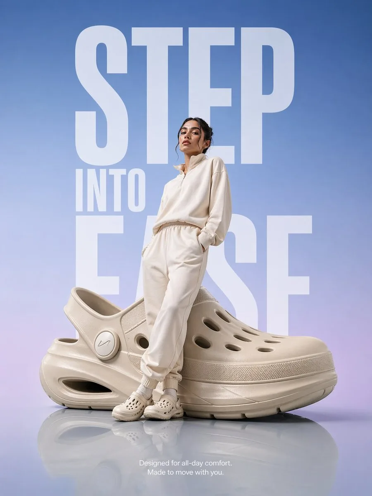

# 𝐌 — by @Strength04_X

[← Back to Examples from X](../../EXAMPLES.md) · Category: Poster Design · Model: `GPT Image`

<a href="https://x.com/Strength04_X/status/2047729312384901449"></a>

Original post: **[@Strength04_X on X](https://x.com/Strength04_X/status/2047729312384901449)** · Creator: [𝐌](https://x.com/Strength04_X)

## Prompt

```text
A hyper-realistic premium product advertisement featuring an oversized futuristic comfort clog placed on a smooth glossy reflective floor. A modern model dressed in soft neutral-toned athleisure (off-white / beige) stands slightly leaning against the giant shoe with a relaxed, confident posture.

Background: clean gradient blending soft sky blue into subtle lavender tones, with massive bold typography in the background reading “STEP INTO EASE” in a modern sans-serif font, stretched vertically and partially behind the subject.

Lighting: high-end studio lighting with soft highlights, gentle reflections on the floor, and subtle rim light outlining the model and product for depth.

Composition: editorial magazine layout, perfectly centered subject, strong negative space, luxury branding feel.

Additional text (small, minimal placement at bottom): “Designed for all-day comfort. Made to move with you.”

Style: ultra-clean, Apple-style minimalism meets fashion campaign, hyper-realistic, premium commercial photography, 8K, sharp details.
```

## Try it

Paste the prompt into **[vinano.ai](https://vinano.ai?utm_source=github&utm_medium=readme&utm_campaign=awesome-image-video-prompts-updating&utm_content=x-page-try)** to generate your own version.

> The image and prompt belong to [@Strength04_X](https://x.com/Strength04_X) and are shown here with credit for reference. Creators can ask for changes or removal by opening an issue.
