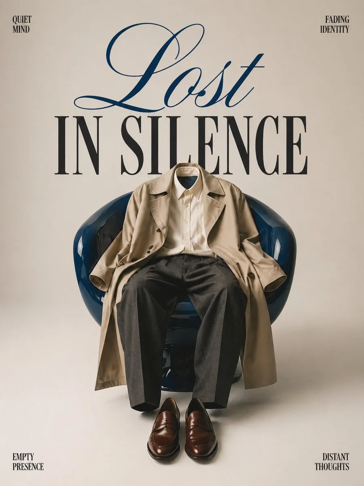

# Sarah — by @AIwithSarah_

[← Back to Examples from X](../../EXAMPLES.md) · Category: Poster Design · Model: `GPT Image`

<a href="https://x.com/AIwithSarah_/status/2048983944922882536"></a>

Original post: **[@AIwithSarah_ on X](https://x.com/AIwithSarah_/status/2048983944922882536)** · Creator: [Sarah](https://x.com/AIwithSarah_)

## Prompt

```text
Minimalist conceptual fashion editorial poster, studio shot on a clean off-white seamless background. A glossy deep blue modern lounge chair placed in the center, with an oversized beige trench coat and tailored charcoal trousers draped naturally over it, creating the illusion of an invisible person sitting there. Polished brown leather loafers placed neatly on the floor in front of the chair. Large elegant typography behind the chair reading “LOST IN SILENCE” — “Lost” in flowing luxury cursive script, “IN SILENCE” in bold serif uppercase. Small subtle text in the corners like “quiet mind,” “fading identity,” “empty presence,” and “distant thoughts.” High-fashion magazine cover aesthetic, cinematic soft lighting, muted tones, surreal emotional atmosphere, clean composition, luxury editorial styling, premium fashion campaign look, artistic and symbolic.
```

## Try it

Paste the prompt into **[vinano.ai](https://vinano.ai?utm_source=github&utm_medium=readme&utm_campaign=awesome-image-video-prompts-updating&utm_content=x-page-try)** to generate your own version.

> The image and prompt belong to [@AIwithSarah_](https://x.com/AIwithSarah_) and are shown here with credit for reference. Creators can ask for changes or removal by opening an issue.
