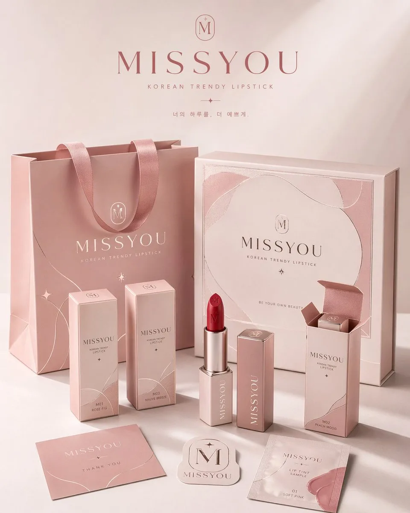

# Larus Canus — by @MrLarus

[← Back to Community Examples](../../EXAMPLES.md) · Category: Product & Brand · Model: `GPT Image`

<a href="https://x.com/MrLarus/status/2047253028462317674"></a>

Source: **[@MrLarus on X](https://x.com/MrLarus/status/2047253028462317674)** · Creator: [Larus Canus](https://x.com/MrLarus)

## Prompt

```text
请为品牌[品牌名称]、类目为[品牌类目]创作一张高审美、高完成度的「品牌包装系统展示图」。这不是普通电商白底图，也不是单一产品图，而是一张具有品牌提案感、视觉识别系统感和商业摄影质感的包装家族陈列效果图。画面需要体现“同一品牌在多个包装载体上的统一落地”，呈现一个成熟消费品牌的完整包装系统。 

【画幅要求】整体必须为固定 4:5 的竖版海报构图，画面方向明确为纵向，禁止生成横版构图、宽幅桌面陈列或过于分散的横向展示。整体构图需符合海报阅读逻辑：上方保留呼吸感，中部为品牌包装系统的主要视觉焦点，下方安排辅助包装、标签和产品本体，整体重心集中，适合直接作为品牌展示海报发布。

【核心要求】根据【类目】自动匹配最合理、最自然的包装组合与产品形态，并围绕【品牌名字】建立统一的品牌视觉系统。画面中应选择少量但有代表性的包装形式，组成一组完整而精炼的品牌包装系统，不追求堆砌数量，而强调主次层级、品牌统一性与陈列美感。可根据类目合理选择以下包装类型中的一部分：手提袋 / 购物袋、纸盒 / 礼盒 / 外包装盒、长条盒 / 单品盒 / 套装盒、包装袋 / 封套 / 小样袋 / 软袋、杯子 / 瓶子 / 罐子 / 管状容器 / 喷雾瓶 / 泵头瓶、标签 / 贴纸 / 封签 / 吊牌 / 小卡片，以及与类目对应的真实产品本体。

【类目适配逻辑】包装形式与产品形态需要根据【类目】自动匹配，但不局限于单一方向。可参考以下适配逻辑自由发散：若类目为食品 / 烘焙 / 零食 / 饮品，则以纸袋、纸盒、包装袋、杯子、食品容器、贴纸、封签及真实产品本体为主；若类目为茶饮 / 咖啡 / 饮料，则以杯子、瓶子、罐装包装、提袋、杯套、封口贴、礼盒等为主；若类目为美妆 / 护肤 / 彩妆 / 香水，则以瓶、罐、管、盒、礼盒、手提袋、小样包装等为主；若类目为香氛 / 家居 / 生活方式，则以香薰瓶、蜡烛杯、包装盒、礼盒、提袋、吊卡、标签卡等为主；若类目为服饰 / 饰品 / 潮玩 / 文创，则以包装盒、抽屉盒、防尘袋、手提袋、贴纸、吊牌、配件包装等为主；若类目为数码配件 / 工具 / 小型消费品，则以硬盒、外包装盒、收纳袋、说明卡、贴纸、封套、标签等为主。整体必须体现“类目合理、品牌统一、包装成体系”的效果。

【数量与密度控制】请控制画面中的物件数量，不要过多堆砌，也不要把所有可能包装形式全部展示出来。整体应呈现“少而精、完整但不拥挤”的品牌包装系统效果。建议选择最具代表性的包装载体进行展示：大件包装 1～2 个，中型包装 2～3 个，小型包装或辅助物件 2～4 个，真实产品本体 1～3 个，总可见元素建议控制在 6～10 个之间。包装种类应体现层次变化与系统感，但不宜重复过多同类物件。画面需要有足够留白与呼吸感，确保每个包装都清晰可见、主次明确、摆放舒展，宁可少而精，也不要为了“完整”而过度塞满。

【品牌视觉系统要求】所有包装必须属于同一个品牌系统，统一使用【品牌名字】作为核心品牌识别元素。整体应具备一致的 logo / 标志呈现、字体风格、图形语言、插画语言或纹样系统、排版逻辑、配色体系、材质与印刷质感。品牌调性、色彩方向、图案元素、辅助图形和视觉氛围，请根据【类目】自动匹配并合理发散，不局限于任何固定风格。整体风格应统一、协调、具有品牌识别度，可以是简约高级、自然有机、时尚现代、轻奢精致、年轻清新、艺术感、潮流个性或经典优雅，但必须符合【类目】特征，并呈现成熟品牌的设计完成度。

【配色机制要求】整体配色不要固化为某一种固定组合，也不要连续多次出现高度相似的主色系统。每次生成时应根据【类目】与品牌气质，主动形成不同的主色方案与配色关系，采用“受控发散”的方式进行色彩演绎。色彩可以是低饱和自然色、现代中性色、轻复古色、明快清新色、轻奢深色系或艺术感综合色系，但必须保持高级、统一、克制、有品牌感。允许每次生成时呈现不同的视觉气质，例如奶油白与焦糖棕、雾灰蓝与暖白、橄榄绿与亚麻米、酒红与奶霜白、可可棕与象牙白、炭灰与麦秆金、雾粉灰与米白、海军蓝与暖灰等，仅作为参考方向而非固定模板。不要荧光色，不要廉价高饱和，不要杂乱失控的多色拼贴。

【画面构图与陈列要求】画面采用品牌包装家族陈列逻辑，而不是杂乱堆放。整体为商业摄影棚场景，使用 3/4 轻俯视角或略带透视的正面陈列角度，形成有层次、有秩序、有主次的包装展示画面。构图参考以下逻辑：后景摆放 1～2 个较大的包装作为视觉支撑，如手提袋、大礼盒、大外盒；中景安排品牌核心包装或主力单品包装，作为主要视觉焦点；前景摆放较小包装、辅助包装、标签、贴纸及真实产品本体；至少有一个真实产品与包装产生自然互动，如产品半露出、摆放在包装前方、与包装组合展示；整体形成平衡而有设计感的三角式或错落式构图。画面干净、有留白、不拥挤，内容丰富但克制，以有限而精准的包装组合体现完整的品牌包装生态。

【视觉风格要求】整体呈现高端商业摄影质感与品牌提案感，背景为干净的摄影棚环境，可为白色、暖白色、浅灰色，或根据品牌调性自动匹配的极简背景。画面应强调真实的包装材质表现、清晰的纸张折痕、盒型结构、瓶罐轮廓、标签细节、印刷质感、压纹 / 烫金 / 哑光 / 棉纸纹理 / 牛皮纸纹理等材质细节，以及统一而高级的配色搭配、精致现代干净的品牌视觉语言和强烈的“这是一整套品牌包装系统”的完整感。

【光影要求】采用真实商业摄影级光影，可为柔和棚拍光，也可带有轻微方向性的自然侧光。需要有清晰但克制的阴影，以增强立体感、空间感与高级感。整体光线通透、明亮、干净，不要阴暗，不要廉价感，不要杂乱背景。

【最终效果要求】最终画面应像一个成熟品牌的包装系统展示海报、包装家族提案图或品牌视觉落地效果图，而不是零散商品拼图。重点突出：固定 4:5 竖版海报感、品牌统一性、包装家族完整性、商业摄影感、设计提案感、类目适配性，以及高级审美与视觉完成度。
```

## Try it

Paste the prompt into **[vinano.ai](https://vinano.ai?utm_source=github&utm_medium=readme&utm_campaign=awesome-image-video-prompts-updating&utm_content=x-page-try)** to generate your own version.

> The image and prompt belong to @MrLarus ([original post](https://x.com/MrLarus/status/2047253028462317674)) and are shown here with credit for reference. Creators can ask for changes or removal by opening an issue.
