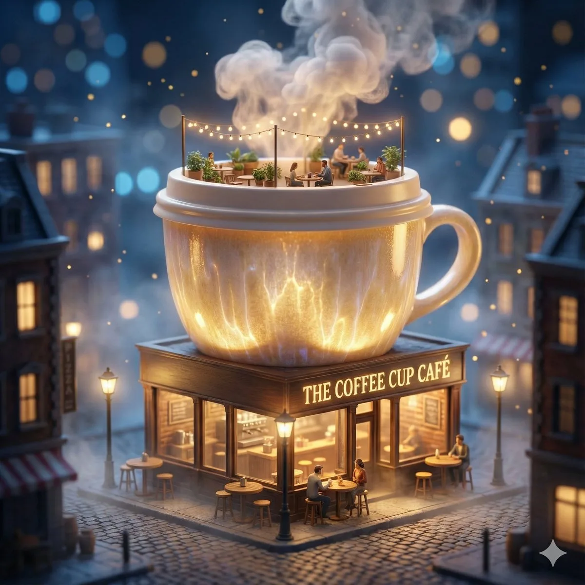

# LOKII — by @TheLOKII_

[← Back to Community Examples](../../EXAMPLES.md) · Category: Product & Brand · Model: `GPT Image`

<a href="https://x.com/TheLOKII_/status/2009310549994283496"></a>

Source: **[@TheLOKII_ on X](https://x.com/TheLOKII_/status/2009310549994283496)** · Creator: [LOKII](https://x.com/TheLOKII_)

## Prompt

```text
ChatGPT Image 1.5 × Google Veo 3.1

→ Nano Banana Pro / GPT-Image 1.5
→ Copy & Paste the Prompt
→ View Results Below ⤵️

Prompt:

A surreal miniature city scene where a giant coffee cup transforms into a cozy café building. The coffee cup forms the main structure, with steam rising like clouds, ceramic textures glowing softly, and the lid acting as a rooftop terrace. The ground floor is a warmly lit café storefront with glass windows, tiny tables, stools, barista counters, and glowing street lamps. Nighttime atmosphere with cinematic bokeh lights, floating particles, soft fog, warm interior glow, hyper-detailed materials, fantasy realism, premium brand storytelling. Tilt-shift effect, ultra-sharp focus, dramatic lighting, square frame, 1080×1080, high-end commercial illustration, ultra-detailed 8K quality.
```

## Try it

Paste the prompt into **[vinano.ai](https://vinano.ai?utm_source=github&utm_medium=readme&utm_campaign=awesome-image-video-prompts-updating&utm_content=x-page-try)** to generate your own version.

> The image and prompt belong to @TheLOKII_ ([original post](https://x.com/TheLOKII_/status/2009310549994283496)) and are shown here with credit for reference. Creators can ask for changes or removal by opening an issue.
