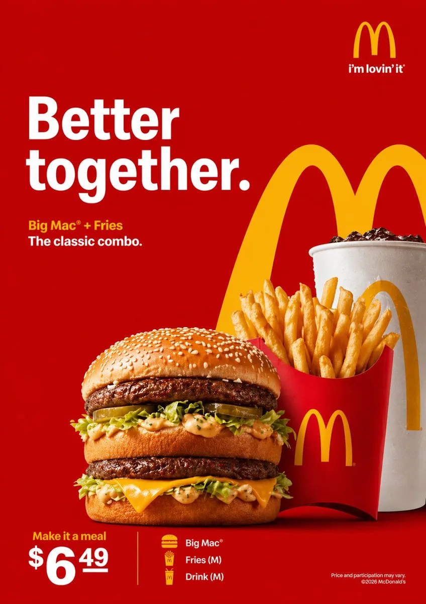

# UxUi Tega (Design &amp; Ai) — by @Tegadesigns

[← Back to Examples from X](../../EXAMPLES.md) · Category: Food & Drink · Model: `GPT Image`

<a href="https://x.com/Tegadesigns/status/2047273916406677721"></a>

Original post: **[@Tegadesigns on X](https://x.com/Tegadesigns/status/2047273916406677721)** · Creator: [UxUi Tega (Design &amp; Ai)](https://x.com/Tegadesigns)

## Prompt

```text
Create a clean, high-quality McDonald’s advertisement.
Use a bold red brand color with yellow brand accents.
Show a Big Mac, fries, and a drink in a realistic, appetizing style.
Include the golden arches in the background.
Add bold white headline text: “Better together.”
Include smaller text: “Big Mac + Fries — The classic combo.”
Add price and minimal product details at the bottom.
Keep the layout simple, balanced, and premium with strong brand consistency.
```

## Try it

Paste the prompt into **[vinano.ai](https://vinano.ai?utm_source=github&utm_medium=readme&utm_campaign=awesome-image-video-prompts-updating&utm_content=x-page-try)** to generate your own version.

> The image and prompt belong to [@Tegadesigns](https://x.com/Tegadesigns) and are shown here with credit for reference. Creators can ask for changes or removal by opening an issue.
