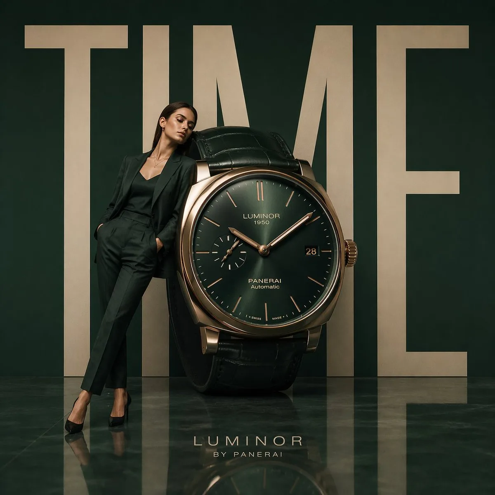

# Smiling Khan — by @AIwithkhan

[← Back to Community Examples](../../EXAMPLES.md) · Category: Poster Design · Model: `GPT Image`

<a href="https://x.com/AIwithkhan/status/2047704906904330554"></a>

Source: **[@AIwithkhan on X](https://x.com/AIwithkhan/status/2047704906904330554)** · Creator: [Smiling Khan](https://x.com/AIwithkhan)

## Prompt

```text
Minimalist luxury watch campaign, oversized wristwatch positioned like modern sculpture, model leaning against the dial, giant word “TIME” in bold typography behind, deep emerald studio background, reflective polished floor, Swiss luxury advertising aesthetic, cinematic editorial styling, ultra-clean composition, 1:1
```

## Try it

Paste the prompt into **[vinano.ai](https://vinano.ai?utm_source=github&utm_medium=readme&utm_campaign=awesome-image-video-prompts-updating&utm_content=x-page-try)** to generate your own version.

> The image and prompt belong to @AIwithkhan ([original post](https://x.com/AIwithkhan/status/2047704906904330554)) and are shown here with credit for reference. Creators can ask for changes or removal by opening an issue.
