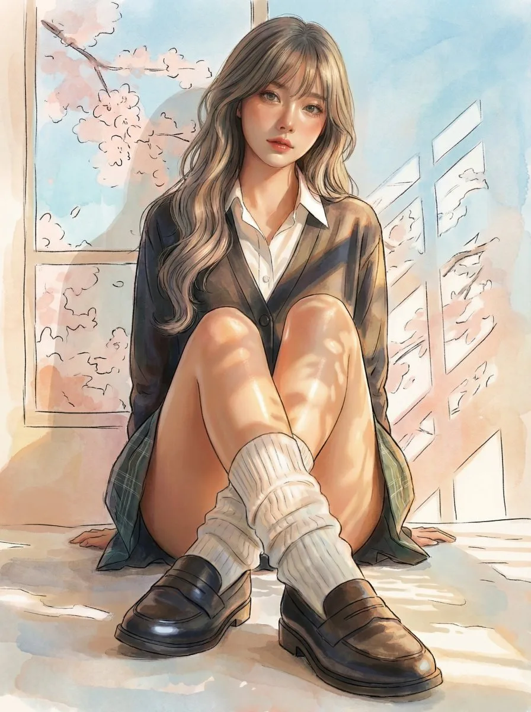

# CHAO2U AI — by @CHAO2U_AI

[← Back to Examples from X](../../EXAMPLES.md) · Category: Photography · Model: `GPT Image`

<a href="https://x.com/CHAO2U_AI/status/2002023740490784993"></a>

Original post: **[@CHAO2U_AI on X](https://x.com/CHAO2U_AI/status/2002023740490784993)** · Creator: [CHAO2U AI](https://x.com/CHAO2U_AI)

## Prompt

```text
Higgsfield just dropped GPT Image 1.5 — I tried the "impossible" test everyone thought would fail:
1⃣ Pure anime illustration only
2⃣ Extract every clothing item while keeping anime style
3⃣ Take those flat 2D clothes
4⃣ Dress a 100% photorealistic girl with them
No LoRA. No training. Just one simple prompt.

Result: pleats fold like real fabric, cardigan has actual weight, socks compress naturally. 
GPT Image 1.5 doesn’t just copy styles — it truly understands clothing physics and materials. Anime uniform on a real human. For real. My brain is broken 🤯✨
#Higgsfield #gptimage
```

## Try it

Paste the prompt into **[vinano.ai](https://vinano.ai?utm_source=github&utm_medium=readme&utm_campaign=awesome-image-video-prompts-updating&utm_content=x-page-try)** to generate your own version.

> The image and prompt belong to [@CHAO2U_AI](https://x.com/CHAO2U_AI) and are shown here with credit for reference. Creators can ask for changes or removal by opening an issue.
