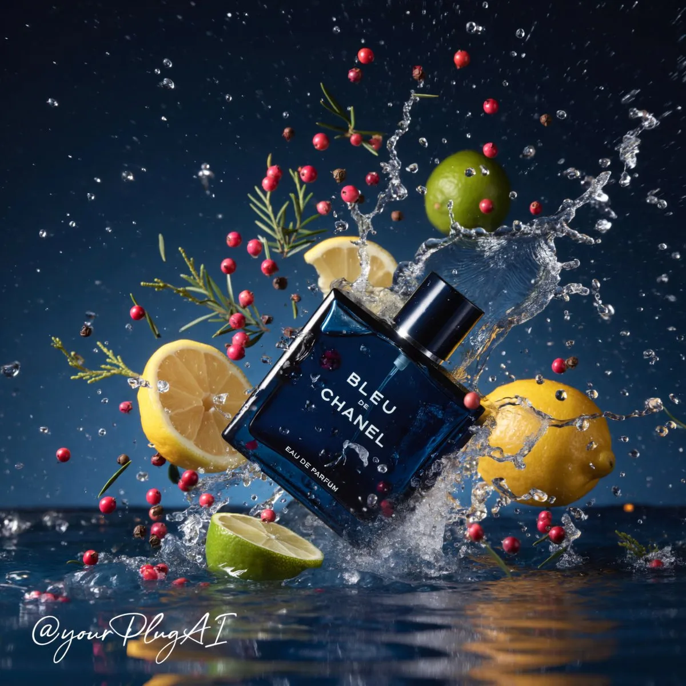

# Gilbert Odera | Your AI Plug🇰🇪 — by @yourPlugAI

[← Back to Examples from X](../../EXAMPLES.md) · Category: Product & Brand · Model: `GPT Image`

<a href="https://x.com/yourPlugAI/status/2048956977250726018"></a>

Original post: **[@yourPlugAI on X](https://x.com/yourPlugAI/status/2048956977250726018)** · Creator: [Gilbert Odera | Your AI Plug🇰🇪](https://x.com/yourPlugAI)

## Prompt

```text
Create a hyper-realistic cinematic luxury perfume product photograph featuring [PERFUME BOTTLE DESIGN] positioned in [COMPOSITION / ANGLE] within a dramatic elemental environment of [ELEMENTAL SETTING: water, smoke, ice, firelight, forest, florals, spices, gemstones].

The bottle should feel premium and tactile, with [MATERIAL DETAILS: glossy glass, metallic cap, gold label, transparent liquid, frosted surface, engraved text], sharp reflections, realistic refractions, and crisp readable branding: [BRAND / LABEL TEXT].

Surround the product with carefully arranged sensory ingredients such as [BOTANICALS / SPICES / FRUITS / OBJECTS], using strong contrast between [PRIMARY COLOR PALETTE] and [ACCENT COLORS].

Lighting should be cinematic and high-contrast, with [LIGHTING STYLE], deep shadows, sparkling highlights, volumetric atmosphere, and a luxurious commercial advertising finish.

Background: [BACKGROUND DESCRIPTION], shallow depth of field, premium editorial composition, ultra-detailed textures, 8k resolution, photorealistic studio quality.


Cheat Sheet
[PERFUME BOTTLE DESIGN]: shape, color, cap, label style
[COMPOSITION / ANGLE]: tilted crash, centered still life, close-up tray, hand interaction
[ELEMENTAL SETTING]: splash, smoke, candlelight, ice, forest, aurora
[MATERIAL DETAILS]: glass, metal, liquid, frost, reflections
[BRAND / LABEL TEXT]: exact readable perfume text
[BOTANICALS / SPICES / FRUITS / OBJECTS]: lemons, vanilla pods, roses, pinecones, gemstones
[PRIMARY COLOR PALETTE]: navy, amber, silver, black, icy blue
[ACCENT COLORS]: gold, red, lime green, magenta, teal
[LIGHTING STYLE]: dramatic spotlight, candle glow, cool moonlight, golden rim light
[BACKGROUND DESCRIPTION]: moody studio, dark forest, blurred luxury interior, smoky backdrop
```

## Try it

Paste the prompt into **[vinano.ai](https://vinano.ai?utm_source=github&utm_medium=readme&utm_campaign=awesome-image-video-prompts-updating&utm_content=x-page-try)** to generate your own version.

> The image and prompt belong to [@yourPlugAI](https://x.com/yourPlugAI) and are shown here with credit for reference. Creators can ask for changes or removal by opening an issue.
