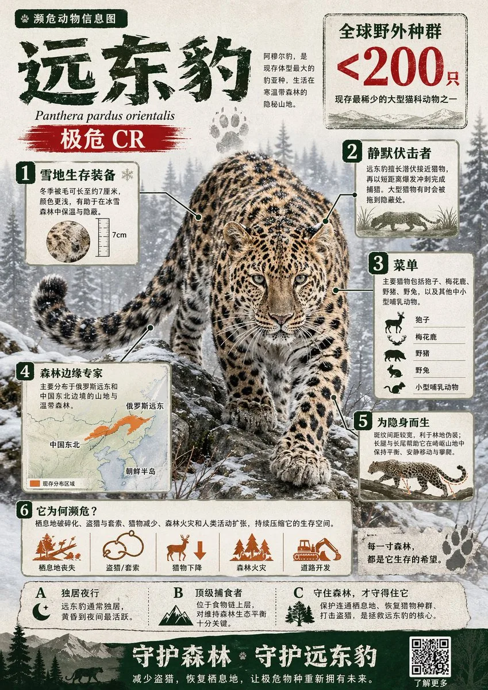

# Bill The Investor — by @billtheinvestor

[← Back to Community Examples](../../EXAMPLES.md) · Category: Poster Design · Model: `GPT Image`

<a href="https://x.com/billtheinvestor/status/2047153211560399009"></a>

Source: **[@billtheinvestor on X](https://x.com/billtheinvestor/status/2047153211560399009)** · Creator: [Bill The Investor](https://x.com/billtheinvestor)

## Prompt

```text
Create a visually rich infographic in Chinese about an endangered animal. Start by finding one online, research its habitat, diet, and unique traits. Present information through annotated visuals and structured callouts, not generic sections. Style it like a bold graphic illustration: a detailed, photorealistic central animal as the focal point, supported by diagrams, callouts, and concise text elements. Use clean backgrounds and a mix of photorealism with strong graphic elements (shapes, icons, color blocking) in a layered composition. Make it dense, tactile, and professionally authored.

猜猜哪个是哪个？
```

## Try it

Paste the prompt into **[vinano.ai](https://vinano.ai?utm_source=github&utm_medium=readme&utm_campaign=awesome-image-video-prompts-updating&utm_content=x-page-try)** to generate your own version.

> The image and prompt belong to @billtheinvestor ([original post](https://x.com/billtheinvestor/status/2047153211560399009)) and are shown here with credit for reference. Creators can ask for changes or removal by opening an issue.
