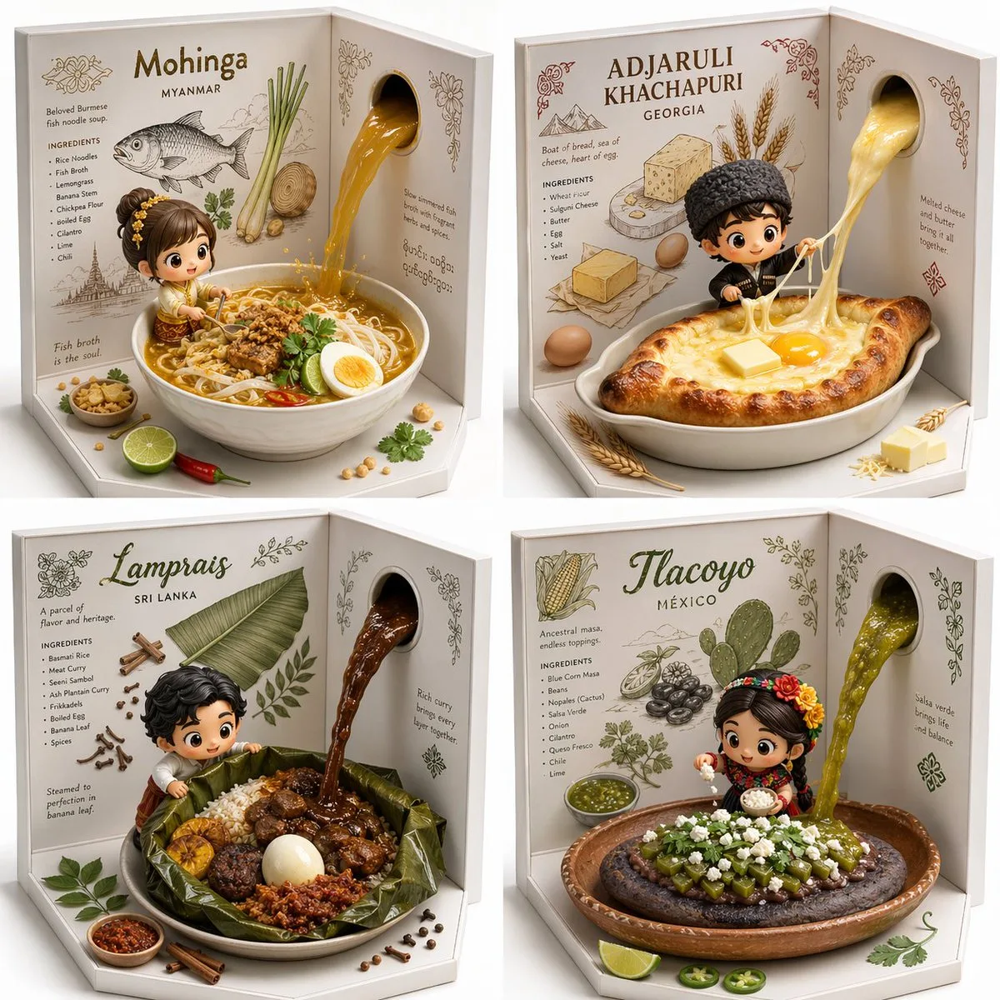

# Gadgetify — by @Gdgtify

[← Back to Community Examples](../../EXAMPLES.md) · Category: Food & Drink · Model: `GPT Image`

<a href="https://x.com/Gdgtify/status/2048091166047158761"></a>

Source: **[@Gdgtify on X](https://x.com/Gdgtify/status/2048091166047158761)** · Creator: [Gadgetify](https://x.com/Gdgtify)

## Prompt

```text
2x2 grid, do this for 4 hidden gem international foods select * from popup_recipe_visualizer where recipe_target = '[dish_name]' and structural_base = 'l-shaped_open_box_white_interior' and wall_layer_2d = ( select line_art, typography, botanical_drawings from ingredient_inference_db where dish = '[dish_name]' ) and foreground_layer_3d = array[ 'bowl_of_completed_[dish_name]', 'kawaii_chibi_mascot_interacting_with_food', 'scattered_3d_garnishes_on_floor' ] and dynamic_action = 'thick_glossy_sauce_pouring_from_2d_wall_hole_into_3d_bowl' and render_engine = 'octane_render_soft_studio_lighting';
```

## Try it

Paste the prompt into **[vinano.ai](https://vinano.ai?utm_source=github&utm_medium=readme&utm_campaign=awesome-image-video-prompts-updating&utm_content=x-page-try)** to generate your own version.

> The image and prompt belong to @Gdgtify ([original post](https://x.com/Gdgtify/status/2048091166047158761)) and are shown here with credit for reference. Creators can ask for changes or removal by opening an issue.
