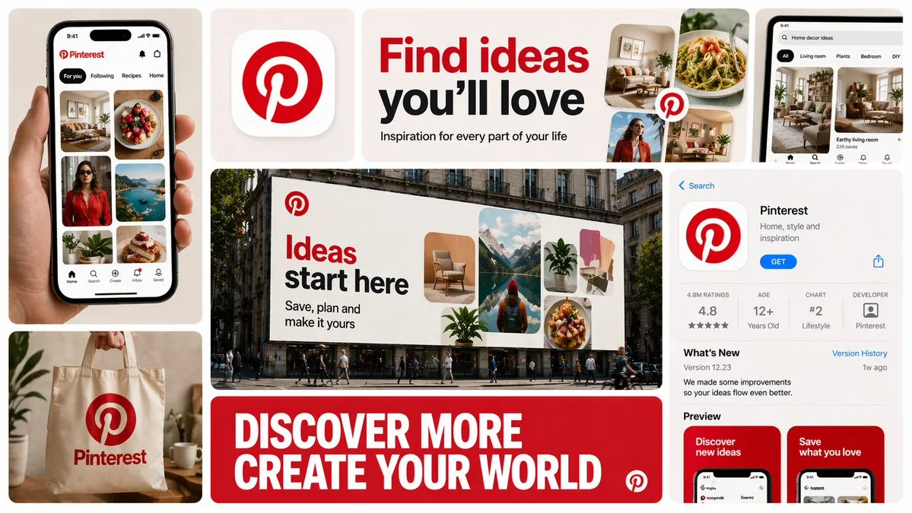

# AmirMušić — by @AmirMushich

[← Back to Examples from X](../../EXAMPLES.md) · Category: Product & Brand · Model: `GPT Image`

<a href="https://x.com/AmirMushich/status/2047420285817929961"></a>

Original post: **[@AmirMushich on X](https://x.com/AmirMushich/status/2047420285817929961)** · Creator: [AmirMušić](https://x.com/AmirMushich)

## Prompt

```text
Create a 16:9 horizontal bento-grid brand collage for [BRAND NAME] in a polished contemporary campaign style.  
Use a fixed 3-row, 4-column bento structure with rounded tiles, equal gaps, clean alignment, and a light neutral background.
The layout must stay consistent across generations, but the content inside each tile must adapt to the real business model, product ecosystem, and brand language of [brand name].

Grid blueprint
Build the composition as 11 visible content zones arranged in a fixed bento layout:
Top-left tile: 1 column × 2 rows, tall vertical hero device or primary brand surface
Top-middle-left tile: 1 column × 1 row, compact square brand asset tile
Top-middle-right tile: 2 columns × 1 row, wide headline/message tile

Center tile: 2 columns × 2 rows, dominant campaign hero scene

Top-right tile: 1 column × 1 row, secondary device / product surface / branded object

Bottom-left tile: 1 column × 1 row, product artifact or branded utility object

Bottom-center tile: 2 columns × 1 row, large bold typography tile

Bottom-right tile: 1 column × 2 rows, tall informational product / interface / feature tile

All tiles must share the same corner radius, spacing system, and visual polish.
The dominant focal points are the large center hero tile, the wide top headline tile, and the wide bottom typography tile.

Adaptive content logic
Do not assume [brand name] is a fintech brand.
Before deciding what appears inside each tile, infer what [brand name] actually is: social platform, SaaS tool, media brand, retailer, hospitality brand, hardware company, mobility app, AI product, consumer app, etc.

Every tile must contain a plausible branded asset based on that business type.

Use this rule:

If [brand name] has a real consumer app, dashboard, product UI, creator interface, booking flow, editor, storefront, feed, player, workspace, or operating surface, use those.

If [brand name] does not realistically have payment cards, watches, or hardware, do not invent them.

Only include branded physical objects when they make sense for the brand: packaging, merch, signage, magazine, laptop sticker, storefront card, delivery box, product box, wearable, poster, notebook, tote, badge, ticket, book, etc.

If the brand is primarily digital, prioritize screens, interface fragments, campaign graphics, app/store listings, editorial visuals, and branded communication assets.

If the brand is a platform, use realistic platform surfaces: profile screens, creator dashboards, boards, playlists, templates, analytics, publishing tools, discovery feeds, search, collaboration views, etc.

If the brand is a physical-product company, use realistic product shots, packaging, product detail pages, retail signage, and lifestyle scenes.

If the brand is a service business, use realistic booking, scheduling, marketplace, onboarding, testimonial, results, or service-delivery interfaces.

If exact assets are unknown, infer the most believable official-looking product and campaign system for [brand name].

Tile-by-tile rules
1) Tall left hero tile
Show the most iconic primary branded surface for [brand name].

Examples:

phone with app UI
laptop with dashboard/editor
tablet with creative workspace
product packaging held in hand
branded poster or printed object
storefront or physical product close-up

This tile should represent the brand’s main touchpoint, not a generic device.

2) Small square brand asset tile
Show a compact brand-signature element:

app icon
logo mark
symbol
product badge
branded motif
miniature packaging unit
icon system object
sticker or seal
simplified 3D brand emblem

This tile should feel like a distilled identity marker.

3) Wide top headline tile
Use a short strategic message that fits [brand name]’s category and tone.
Do not repeat generic fintech copy.
The line should feel like a real campaign headline for that specific brand.

Examples of direction:

discovery
creativity
organization
inspiration
connection
travel
productivity
expression
streaming
collaboration
automation

Use large, bold, high-contrast typography.

4) Large center hero tile
Create the main campaign scene for [brand name] in a real-world or branded-environment context.
This should be the most expressive tile.

Possible formats:
outdoor billboard
subway poster
retail installation
city poster wall
laptop-on-desk hero scene
creator workspace
product-in-use lifestyle shot
editorial campaign image
interface projected into environment
branded event signage
The scene must make sense for the brand’s world and audience.

5) Top-right support tile
Show a secondary but still realistic brand surface:

another device view
product detail
branded object
campaign variation
interface zoom-in
packaging angle
social post mockup
desktop widget
creator tool panel
notification / discovery / search view

This tile should complement the main touchpoint, not duplicate it exactly.

6) Bottom-left artifact tile
Show a category-appropriate branded artifact, not a fixed “bank card”.

Choose the artifact based on [brand name]:

for fintech: payment card, wallet pass, transfer screen, exchange card

for social/media: creator card, profile card, post template, content preview, board tile, channel card

for SaaS/productivity: workspace card, document preview, template card, dashboard widget

for e-commerce/retail: packaging, shipping box, loyalty pass, product tag, order card

for travel/hospitality: booking card, room key, boarding-style pass, itinerary card

for music/media: album card, playlist card, player card, event ticket

for AI/software: prompt card, generation result card, model card, workflow card

This tile must feel like a believable branded unit of value for that company.

7) Wide bottom message tile
Use one strong oversized statement in uppercase or bold display typography.
This is not necessarily the slogan from the top tile; it can be a broader campaign line or category promise.

The message must match the actual brand behavior of [brand name].
For example, do not use “MOVE MONEY WITHOUT BORDERS” unless the brand actually deals with payments or finance.

8) Tall right informational tile
Show a structured branded information surface:
app store page
product page
onboarding screen
feature overview
marketplace listing
creator profile
brand campaign landing screen
dashboard overview
editorial page
discovery feed
help center / setup / feature panel
This tile should add product depth and make the collage feel like a full brand system.

Brand realism rules
Use the real or highly plausible brand identity of [brand name]: logo, color palette, typography feel, icon language, image treatment, interface style, and tone of voice.
If exact assets are unavailable, invent only what is necessary, but make it feel like the official visual system of [brand name].

Do not force a product category onto the brand.
Do not invent impossible hardware, payment tools, packaging, or app features unless they are realistic adjacent extensions of the brand.
Prefer believable brand adaptation over visual symmetry.

Visual consistency rules
Even though tile content is adaptive, the final image must still feel like one campaign system:

same overall grid structure
same tile spacing
same corner radius
same art direction quality
same brand palette across all tiles
consistent typography logic
consistent mockup realism
consistent lighting and polish

Style
Clean premium brand presentation, high detail, polished mockup realism, soft shadows, strong hierarchy, editorial-quality composition, modern campaign aesthetics.
Avoid random collage chaos.
Avoid tiny unreadable text.
Avoid generic placeholder UI.
Keep the structure fixed, but let the objects and branded surfaces adapt intelligently to [brand name].

Stronger one-line instruction

Important: the layout is fixed, but the objects are not fixed.
For each generation, select tile content based on what [brand name] realistically sells, ships, publishes, displays, or lets users interact with.
Never insert category-inappropriate objects just to fill the grid.
```

## Try it

Paste the prompt into **[vinano.ai](https://vinano.ai?utm_source=github&utm_medium=readme&utm_campaign=awesome-image-video-prompts-updating&utm_content=x-page-try)** to generate your own version.

> The image and prompt belong to [@AmirMushich](https://x.com/AmirMushich) and are shown here with credit for reference. Creators can ask for changes or removal by opening an issue.
