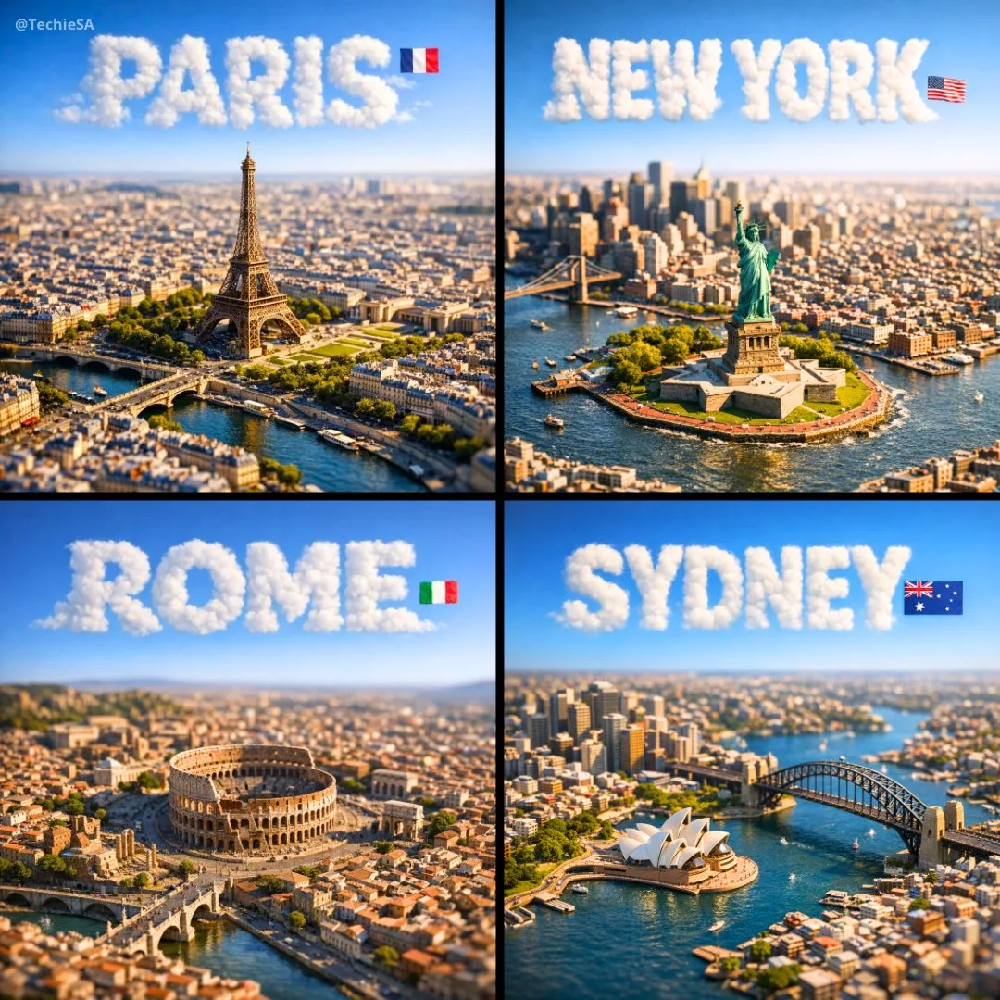

# TechieSA — by @TechieBySA

[← Back to Examples from X](../../EXAMPLES.md) · Category: Illustration & 3D · Model: `GPT Image`

<a href="https://x.com/TechieBySA/status/2010080445619417602"></a>

Original post: **[@TechieBySA on X](https://x.com/TechieBySA/status/2010080445619417602)** · Creator: [TechieSA](https://x.com/TechieBySA)

## Prompt

```text
A square, 1:1 photorealistic close-up photograph of an incredibly detailed physical miniature geography and city model of [CITY], focused only on the city’s most recognizable landmark area (not the full city map).

The scene shows a compact 3D topographic environment built around the iconic landmark zone — realistic terrain, elevation changes, nearby rivers or coastline if relevant, and surrounding urban density scaled naturally to highlight the landmark as the clear focal point. The model feels like a premium museum diorama rather than a map.

Thousands of tiny, highly detailed buildings, roads, bridges, and infrastructure cluster organically around the landmark. The landmark itself rises prominently above everything else, instantly recognizable even at a glance.

Strong natural side sunlight casts long, realistic shadows across the miniature terrain, enhancing depth and realism. Shallow depth of field (tilt-shift style) keeps the landmark zone sharply in focus while softly blurring the outer edges of the square frame. The entire scene appears as a tangible, physical model illuminated by real-world light.

Above the city, the sky is perfectly clean and empty — no clouds at all — except for the city name.

The name [CITY] appears integrated into the sky as thick, three-dimensional cloud typography, sculpted from dense white vapor. The letters are bold, volumetric, and clearly readable, with soft shadowing and subtle depth, floating naturally in the open sky. Opacity ~70%, but with enough thickness to remain instantly legible.

A small, minimal national flag is placed subtly near the sky text (corner or aligned to the typography), balanced and unobtrusive.

Format: Square 1080×1080
Style: Ultra-photorealistic, cinematic, premium miniature realism
Mood: Awe, clarity, instantly recognizable, highly shareable
```

## Try it

Paste the prompt into **[vinano.ai](https://vinano.ai?utm_source=github&utm_medium=readme&utm_campaign=awesome-image-video-prompts-updating&utm_content=x-page-try)** to generate your own version.

> The image and prompt belong to [@TechieBySA](https://x.com/TechieBySA) and are shown here with credit for reference. Creators can ask for changes or removal by opening an issue.
