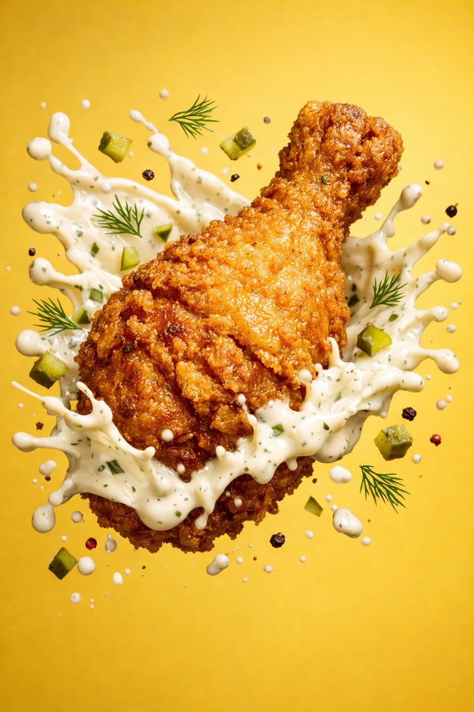

# ShaHid WaNii — by @meng_dagg695

[← Back to Community Examples](../../EXAMPLES.md) · Category: Food & Drink · Model: `GPT Image`

<a href="https://x.com/meng_dagg695/status/2007269989359948066"></a>

Source: **[@meng_dagg695 on X](https://x.com/meng_dagg695/status/2007269989359948066)** · Creator: [ShaHid WaNii](https://x.com/meng_dagg695)

## Prompt

```text
Epic 8K cinematic fantasy food scene: a colossal crispy fried chicken leg rising like a legendary artifact through a tidal explosion of molten creamy sauce. Sauce behaves like liquid clouds, forming waves and splashes in mid-air. Pickle chunks, herb leaves, and seasoning particles float like asteroids in a food universe. Extreme macro texture on the crust—cracks, bubbles, and crunch visible. Powerful dramatic lighting with deep shadows and glowing highlights. Vibrant golden-yellow background with cinematic depth and atmospheric particles. Hyper-realistic yet mythic, bold surreal advertising masterpiece.
```

## Try it

Paste the prompt into **[vinano.ai](https://vinano.ai?utm_source=github&utm_medium=readme&utm_campaign=awesome-image-video-prompts-updating&utm_content=x-page-try)** to generate your own version.

> The image and prompt belong to @meng_dagg695 ([original post](https://x.com/meng_dagg695/status/2007269989359948066)) and are shown here with credit for reference. Creators can ask for changes or removal by opening an issue.
