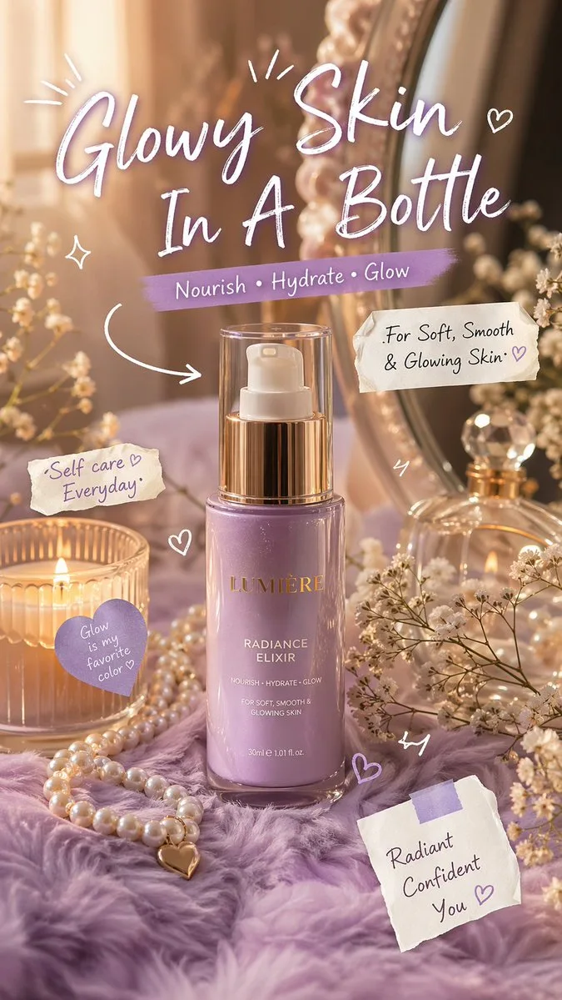

# simeon-sanai — by @Naiknelofar788

[← Back to Community Examples](../../EXAMPLES.md) · Category: Poster Design · Model: `GPT Image`

<a href="https://x.com/Naiknelofar788/status/2047645038147166555"></a>

Source: **[@Naiknelofar788 on X](https://x.com/Naiknelofar788/status/2047645038147166555)** · Creator: [simeon-sanai](https://x.com/Naiknelofar788)

## Prompt

```text
Luxury aesthetic skincare advertisement,soft pastel background, warm golden sunlight, dreamy soft focus, feminine vanity setup with mirror, pearls, candle and baby breath flowers.Cozy purple fluffy surface, high-end beauty branding style, ultra realistic, 4k, studio lighting, glossy reflection, soft shadows, bokeh background.
Add cute doodle elements (white and purple hand-drawn arrows, sparkles, hearts), handwritten notes and stickers.

Text overlay: "Glowy Skin In A Bottle" (big hand writing font)"Nourish • Hydrate • Glow"
"For Soft, Smooth & Glowing Skin","Self care Everyday"
clean composition, aesthetic, viral beauty ad style, Instagram / TikTok/ X friendly (but no UI), premium soft feminine branding
```

## Try it

Paste the prompt into **[vinano.ai](https://vinano.ai?utm_source=github&utm_medium=readme&utm_campaign=awesome-image-video-prompts-updating&utm_content=x-page-try)** to generate your own version.

> The image and prompt belong to @Naiknelofar788 ([original post](https://x.com/Naiknelofar788/status/2047645038147166555)) and are shown here with credit for reference. Creators can ask for changes or removal by opening an issue.
