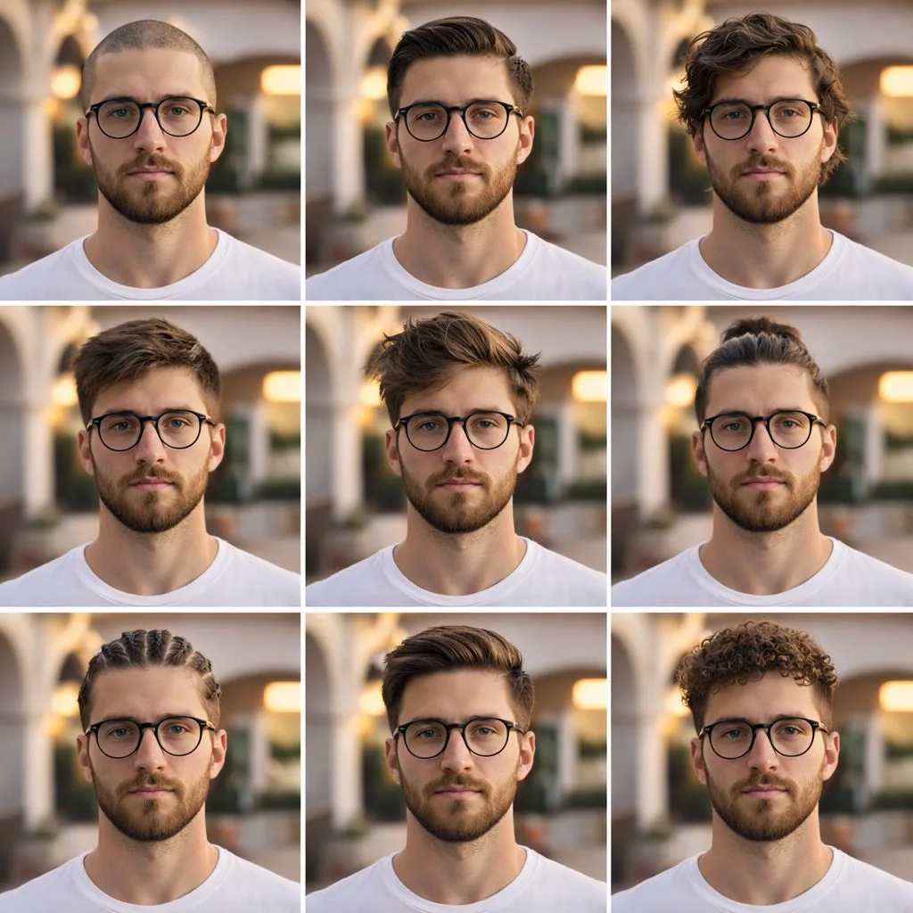

# Duet | AI — by @Sheldon056

[← Back to Community Examples](../../EXAMPLES.md) · Category: Photography · Model: `GPT Image`

<a href="https://x.com/Sheldon056/status/2001987275119538341"></a>

Source: **[@Sheldon056 on X](https://x.com/Sheldon056/status/2001987275119538341)** · Creator: [Duet | AI](https://x.com/Sheldon056)

## Prompt

```text
description: "A clean, aesthetic 3x3 collage portrait showcasing different men's hairstyles. The same young man is captured in each frame, positioned in consistent lighting and pose, creating a style comparison grid.",

  "subject": {
    "type": "young man",
    "age": "early 20s",
    "skin_tone": "medium with smooth texture",
    "facial_features": "sharp jawline, well-groomed beard stubble, symmetrical face",
    "expression": "neutral and confident"
  },

  "hairstyles": [
    "clean shaved buzz cut",
    "slicked back classic hairstyle",
    "medium wavy long hair",
    "short textured fringe",
    "voluminous messy hairstyle",
    "man bun",
    "cornrow braids",
    "side swept modern fade",
    "tight curly textured cut"
  ],

  "environment": {
    "location": "outdoor courtyard with white architecture arches",
    "lighting": "soft sunset golden-hour lighting",
    "background": "slightly blurred but clean and minimal"
  },

  "camera": {
    "shot": "shoulder-level portrait",
    "angle": "eye-level",
    "lens": "standard lens (50mm)",
    "composition": "consistent framing for all nine shots"
  },

  "wardrobe": {
    "top": "plain fitted white t-shirt",
    "style": "minimal, clean, modern"
  },

  "mood": [
    "stylish",
    "fresh",
    "groomed",
    "aesthetic"
  ]
}
```

## Try it

Paste the prompt into **[vinano.ai](https://vinano.ai?utm_source=github&utm_medium=readme&utm_campaign=awesome-image-video-prompts-updating&utm_content=x-page-try)** to generate your own version.

> The image and prompt belong to @Sheldon056 ([original post](https://x.com/Sheldon056/status/2001987275119538341)) and are shown here with credit for reference. Creators can ask for changes or removal by opening an issue.
