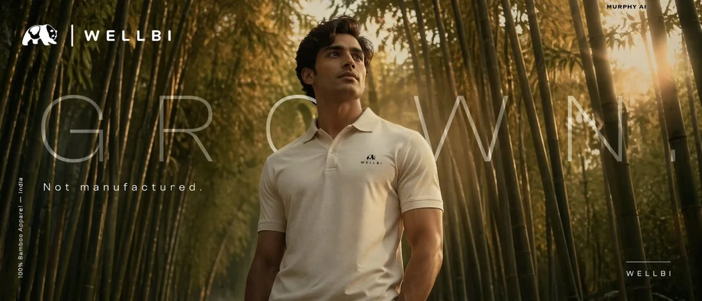

# ᴍᴜʀᴘʜʏ — by @Diplomeme

[← Back to Community Examples](../../EXAMPLES.md) · Category: Poster Design · Model: `GPT Image`

<a href="https://x.com/Diplomeme/status/2047654588657156577"></a>

Source: **[@Diplomeme on X](https://x.com/Diplomeme/status/2047654588657156577)** · Creator: [ᴍᴜʀᴘʜʏ](https://x.com/Diplomeme)

## Prompt

```text
Cinematic product poster for WELLBI, India's premium bamboo apparel brand.

SCENE: A lone young Indian man emerges from a dense, luminous bamboo forest 
at golden hour. Wears a perfectly draped, ultra-clean ivory WELLBI bamboo polo. 
Bamboo stalks alive with warm amber and jade light filtering through canopy.

VISUAL STORYTELLING: The bamboo forest IS the fabric — seamless living metaphor. 
Thin golden light rays land on the polo, suggesting softness and breathability.

COMPOSITION: Low angle, subject centre-frame, bamboo framing both sides like 
a natural arch. Horizon at lower third. Cinematic 2.39:1 anamorphic crop.

— TYPOGRAPHY SYSTEM —
Hero line: "GROWN." — single word, massive scale, Helvetica Neue Ultra Light, 
all caps, extreme letter-spacing +600, ghost white at 15% opacity overlaid 
across the ENTIRE poster width — architectural, not decorative.

Sub-line: "Not manufactured." — set in sharp Aktiv Grotesk Regular, 
sentence case, 18pt, tracking +80, positioned directly below hero word.
White. Full opacity. Feels like a whisper after a shout.

Brand name: "WELLBI" — bottom right corner. Neutral Grotesk Medium, 
all caps, tracking +300, 11pt. Separated by a 0.5pt hairline rule 
above it, 40px wide. Restrained. Premium.

Legal/descriptor: "100% Bamboo Apparel — India" — micro text, 
7pt, tracking +150, bottom left. Rotated 90° vertical. 
Acts as a structural edge element, not an afterthought.

COLOUR PALETTE: Deep jungle green, warm amber, ivory white, earth brown.

LIGHTING: ARRI Alexa Mini LF — golden hour rim, diffused fill, 
subtle lens flare grazing the polo fabric.

MOOD: Grounded luxury. Like a Loro Piana campaign shot in Assam.

CAMERA: 85mm f/1.4, shallow DOF, anamorphic lens flare.

Editorial brand poster for WELLBI sustainable Indian fashion.

SCENE: Extreme close-up of a weathered artisan's hands spinning bamboo thread. 
Blurred WELLBI tee draped elegantly in background. Warm-lit rural Indian 
workshop — clay walls, raw natural light.

VISUAL STORYTELLING: Rough hands against silk-smooth bamboo fabric. 
Heritage craftsmanship. The contrast IS the message.

COMPOSITION: Split tonal — dark warm left (hands, workshop), 
light cream right (garment). Hands at cross-point. Leica 50mm documentary realism.

— TYPOGRAPHY SYSTEM —
Hero line: "ONE LAKH HANDS." — Canela Display Thin, mixed case, 
enormous scale, set across 80% of poster width. 
The word "HANDS" drops to second line, indented right — 
staggered layout creates visual rhythm like musical notation.

Counter-line: Below "HANDS", flush right: "One fabric." — 
same Canela Thin but 28pt, italic. The tonal shift from 
all-caps to italic sentence case creates emotional contrast — 
like going from statement to confession.

Brand stamp: "WELLBI" centred bottom — pressed as if letterpress embossed. 
Freight Display Pro Bold, tracked tight at -20. Earthen cream on warm brown.
Feels physical. Tactile.

Descriptor line: "Handcrafted bamboo apparel since 2021 — India" — 
9pt, Suisse Int'l Light, tracking +200, full width, very bottom edge. 
Reads like a footnote on a heritage certificate.

COLOUR: Terracotta, aged ivory, saffron gold, deep walnut.

LIGHTING: Soft natural window light, warm practical lamp. 
Documentary-editorial quality.

MOOD: Deeply human. D&AD craft award energy.

CAMERA: Leica 50mm Summilux, skin texture visible, 
documentary realism with fashion editorial polish.
```

## Try it

Paste the prompt into **[vinano.ai](https://vinano.ai?utm_source=github&utm_medium=readme&utm_campaign=awesome-image-video-prompts-updating&utm_content=x-page-try)** to generate your own version.

> The image and prompt belong to @Diplomeme ([original post](https://x.com/Diplomeme/status/2047654588657156577)) and are shown here with credit for reference. Creators can ask for changes or removal by opening an issue.
