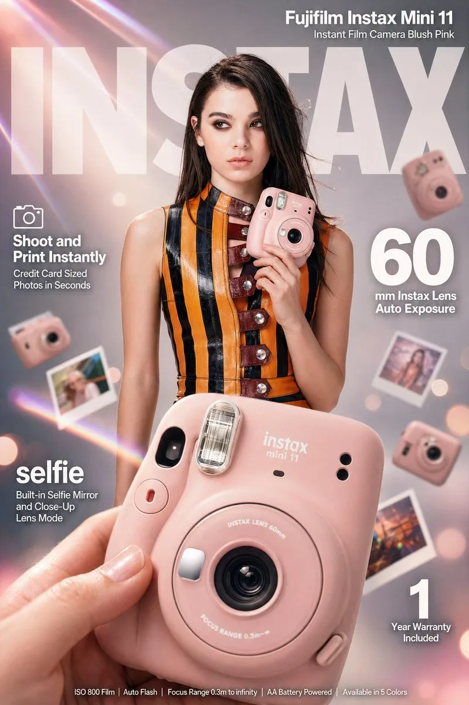

# ShaHid WaNii — by @meng_dagg695

[← Back to Examples from X](../../EXAMPLES.md) · Category: Poster Design · Model: `GPT Image`

<a href="https://x.com/meng_dagg695/status/2048636069349138568"></a>

Original post: **[@meng_dagg695 on X](https://x.com/meng_dagg695/status/2048636069349138568)** · Creator: [ShaHid WaNii](https://x.com/meng_dagg695)

## Prompt

```text
High-impact e-commerce infographic advertisement for "Fujifilm Instax Mini 11" blush pink instant camera. FOREGROUND: Extreme close-up of a hand holding a compact rounded blush-pink Fujifilm Instax Mini 11 camera angled toward camera, razor-sharp center focus, macro-lens shallow depth of field, visible 60mm silver lens ring, crystal pop-up flash, white instax mini 11 branding on body, red shutter button accent, fingertips softly blurred at edges. CENTRAL MODEL: confident young woman with straight dark brown hair, light natural makeup, cool editorial expression, wearing a bold orange and black vertical-striped sleeveless leather mini dress with deep red buckle details and silver stud buttons, holding the blush-pink Instax Mini 11 casually at chest height with camera face pointing outward, slight off-camera gaze, stylish composed energy. BACKGROUND: soft-focus cool light gray gradient studio backdrop fading to warm white center, diagonal pastel prism lens flares in pink peach and lavender cutting upper-left to lower-right, soft blush-pink and cream light leaks at corners, 4 to 5 blurred Fujifilm Instax Mini 11 cameras floating at various depths and rotation angles, scattered polaroid-style instant photo prints in background bokeh, subtle bokeh circles from studio lights. LIGHTING: professional three-point studio lighting, key light upper-left, fill light right side, rim light behind model for separation, glossy highlights on camera lens ring and flash unit. TYPOGRAPHY overlaid clean bold white sans-serif: massive semi-transparent "INSTAX" text spanning full width behind model at top center, top right bold text "Fujifilm Instax Mini 11" with subtitle "Instant Film Camera Blush Pink", mid-left small camera icon with bold "Shoot and Print Instantly" and subtext "Credit Card Sized Photos in Seconds", mid-right extra-large bold numeral "60" with smaller text "mm Instax Lens Auto Exposure", lower-left bold "selfie" with subtext "Built-in Selfie Mirror and Close-Up Lens Mode", bottom-right bold numeral "1" with subtext "Year Warranty Included", bottom center fine print "ISO 800 Film | Auto Flash | Focus Range 0.3m to infinity | AA Battery Powered | Available in 5 Colors". TECHNICAL: 8K ultra-sharp, hyperrealistic commercial ad aesthetic, editorial fashion meets lifestyle product photography style, color palette blush pink orange black cream pastel prism accents, tack-sharp on Instax camera with shallow DOF on everything else, 85mm macro slight low angle, warm vibrant professional color grading.
```

## Try it

Paste the prompt into **[vinano.ai](https://vinano.ai?utm_source=github&utm_medium=readme&utm_campaign=awesome-image-video-prompts-updating&utm_content=x-page-try)** to generate your own version.

> The image and prompt belong to [@meng_dagg695](https://x.com/meng_dagg695) and are shown here with credit for reference. Creators can ask for changes or removal by opening an issue.
