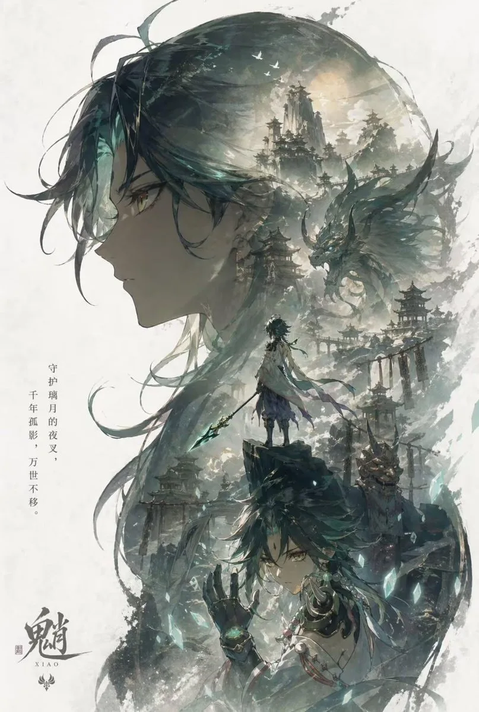

# Anissa — by @SimplyAnnisa

[← Back to Examples from X](../../EXAMPLES.md) · Category: Illustration & 3D · Model: `GPT Image`

<a href="https://x.com/SimplyAnnisa/status/2048961908238070178"></a>

Original post: **[@SimplyAnnisa on X](https://x.com/SimplyAnnisa/status/2048961908238070178)** · Creator: [Anissa](https://x.com/SimplyAnnisa)

## Prompt

```text
Create a character promotional poster for “[XXX]”, using a unified vertical (portrait) key visual composition.
Each poster follows a hierarchy of large top / smaller bottom structure:
The upper half of the composition features a highly recognizable large silhouette of the character — focusing on the head, facial contour, mask, or upper-body outline — forming a bold and iconic primary visual.
The middle to lower section includes a full-body version of the character as the secondary subject, shown in a stable standing pose or with subtle motion, serving as the visual core of the composition.
Inside the large silhouette and around the character, apply double exposure and collage-style storytelling, blending multiple scenes, symbolic elements, small character interactions, supporting visuals, and environments into layered compositions of mist, ink wash, and negative space.
On both the left and right sides, place complementary supporting elements to create narrative tension and spatial balance.
A flowing visual line should run through the entire composition (top to bottom), connecting the main character, internal collage elements, and the large silhouette above — enhancing cohesion and guiding the viewer’s eye.
The overall composition should preserve large areas of negative space, with edges treated using ink diffusion, soft blurring, and fragmented fading, evoking an Eastern aesthetic of balance between emptiness and form.
The overall style should feel refined, restrained, premium, and cohesive, emphasizing depth, storytelling, strong visual impact, and a consistent series identity.
Aspect ratio: 9:16.
```

## Try it

Paste the prompt into **[vinano.ai](https://vinano.ai?utm_source=github&utm_medium=readme&utm_campaign=awesome-image-video-prompts-updating&utm_content=x-page-try)** to generate your own version.

> The image and prompt belong to [@SimplyAnnisa](https://x.com/SimplyAnnisa) and are shown here with credit for reference. Creators can ask for changes or removal by opening an issue.
