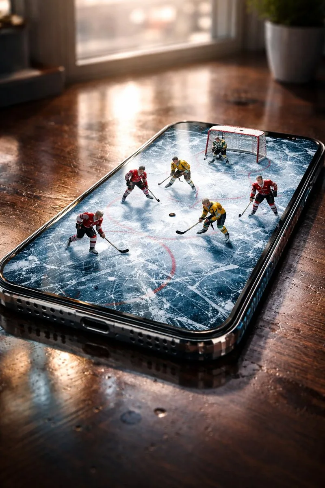

# 𝐌 — by @Strength04_X

[← Back to Examples from X](../../EXAMPLES.md) · Category: Photography · Model: `GPT Image`

<a href="https://x.com/Strength04_X/status/2007711515458318421"></a>

Original post: **[@Strength04_X on X](https://x.com/Strength04_X/status/2007711515458318421)** · Creator: [𝐌](https://x.com/Strength04_X)

## Prompt

```text
Create a hyper-realistic, stylish vertical poster featuring a smartphone lying on a table, transformed into a hockey rink. The screen resembles cracked ice with deep fissures, while tiny hockey players compete in an intense game Use diffused daylight with elegant reflections and refractions to enhance depth. Add realistic details like fingerprints, smudges, and subtle scratches on the phone's surface for authenticity. Craft a dynamic perspective with an intriguing camera angle-slightly tilted for dramatic effect. The image should look like a high-quality DSLR photograph, with sharp focus, rich textures, and cinematic lighting to amplify the surreal yet lifelike atmosphere
```

## Try it

Paste the prompt into **[vinano.ai](https://vinano.ai?utm_source=github&utm_medium=readme&utm_campaign=awesome-image-video-prompts-updating&utm_content=x-page-try)** to generate your own version.

> The image and prompt belong to [@Strength04_X](https://x.com/Strength04_X) and are shown here with credit for reference. Creators can ask for changes or removal by opening an issue.
