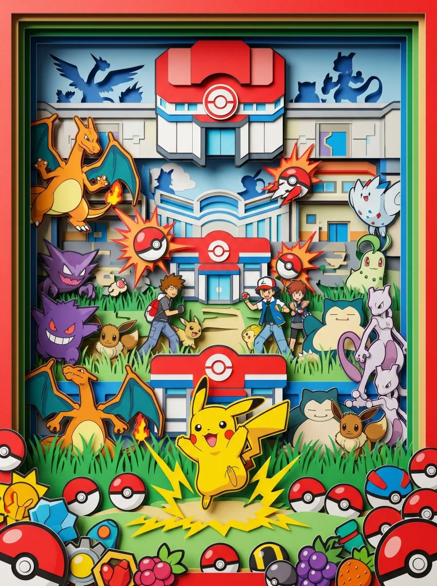

# 两斤 — by @0x00_Krypt

[← Back to Community Examples](../../EXAMPLES.md) · Category: Illustration & 3D · Model: `GPT Image`

<a href="https://x.com/0x00_Krypt/status/2046881068578689257"></a>

Source: **[@0x00_Krypt on X](https://x.com/0x00_Krypt/status/2046881068578689257)** · Creator: [两斤](https://x.com/0x00_Krypt)

## Prompt

```text
Eye-level straight-on view, looking directly into a hyper-vibrant 3D layered paper cut-out diorama.
Pokéball red and white, Pikachu yellow, sky blue and
grass green accents, extremely high saturation,
PHYSICAL PAPER LAYERS clearly visible with hard cut edges and thick paper cross-sections at every depth plane. Maximalist composition, crowded Pokémon world scene — layered Pokémon Center and gym architecture receding through all depth planes,
Pikachu as central figure mid-thunderbolt on foreground layer, dozens of iconic Pokémon — Charizard, Gengar, Eevee, Snorlax, Mewtwo — each inhabiting separate depth planes, trainer Ash and rivals threading between battle layers, Pokéball burst effects frozen mid-release across all planes, tall grass and route pathways between habitat layers, legendary Pokémon silhouettes in remote background layers,
scattered Pokéballs, badges and berry items crowding the vibrant foreground. Soft single-direction studio lighting creating deep drop shadows between every physical paper layer, matte paper texture throughout,
NO glow, NO soft edges, NO volumetric lighting, octane render, 8k, clean details --ar 3:4
```

## Try it

Paste the prompt into **[vinano.ai](https://vinano.ai?utm_source=github&utm_medium=readme&utm_campaign=awesome-image-video-prompts-updating&utm_content=x-page-try)** to generate your own version.

> The image and prompt belong to @0x00_Krypt ([original post](https://x.com/0x00_Krypt/status/2046881068578689257)) and are shown here with credit for reference. Creators can ask for changes or removal by opening an issue.
