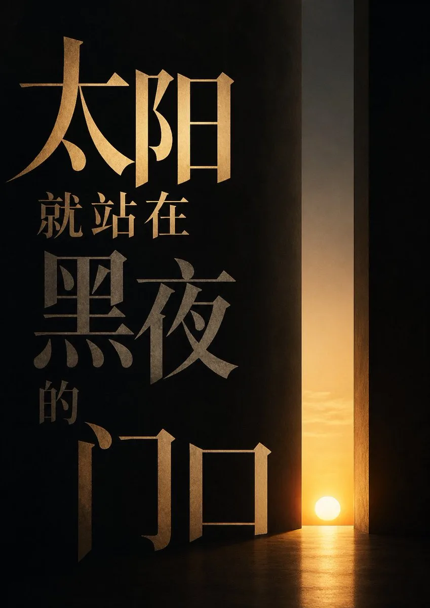

# 小小东 — by @xiaoxiaodong01

[← Back to Community Examples](../../EXAMPLES.md) · Category: Poster Design · Model: `GPT Image`

<a href="https://x.com/xiaoxiaodong01/status/2047875746711171155"></a>

Source: **[@xiaoxiaodong01 on X](https://x.com/xiaoxiaodong01/status/2047875746711171155)** · Creator: [小小东](https://x.com/xiaoxiaodong01)

## Prompt

````text
本次是生成图片任务：
苹果设计师思维，顶级海报大师思维，用高桥流思路
呈现海报设计
表现如下文本，让其抓人，直击人心
你可以智能理解文本，不一定照单全收文本，智能梳理文本， 把握人性，突出看点。尤其是我输入大段文本， 你核心呈现的，应该是你理解和处理后的核心文本
智能判定适合文本语义的配色逻辑，合理排版，有呼吸感的呈现文案
不要额外添加文字， 超大字展示这个文案
```
[太阳就站在黑夜的门口]
```
````

## Try it

Paste the prompt into **[vinano.ai](https://vinano.ai?utm_source=github&utm_medium=readme&utm_campaign=awesome-image-video-prompts-updating&utm_content=x-page-try)** to generate your own version.

> The image and prompt belong to @xiaoxiaodong01 ([original post](https://x.com/xiaoxiaodong01/status/2047875746711171155)) and are shown here with credit for reference. Creators can ask for changes or removal by opening an issue.
