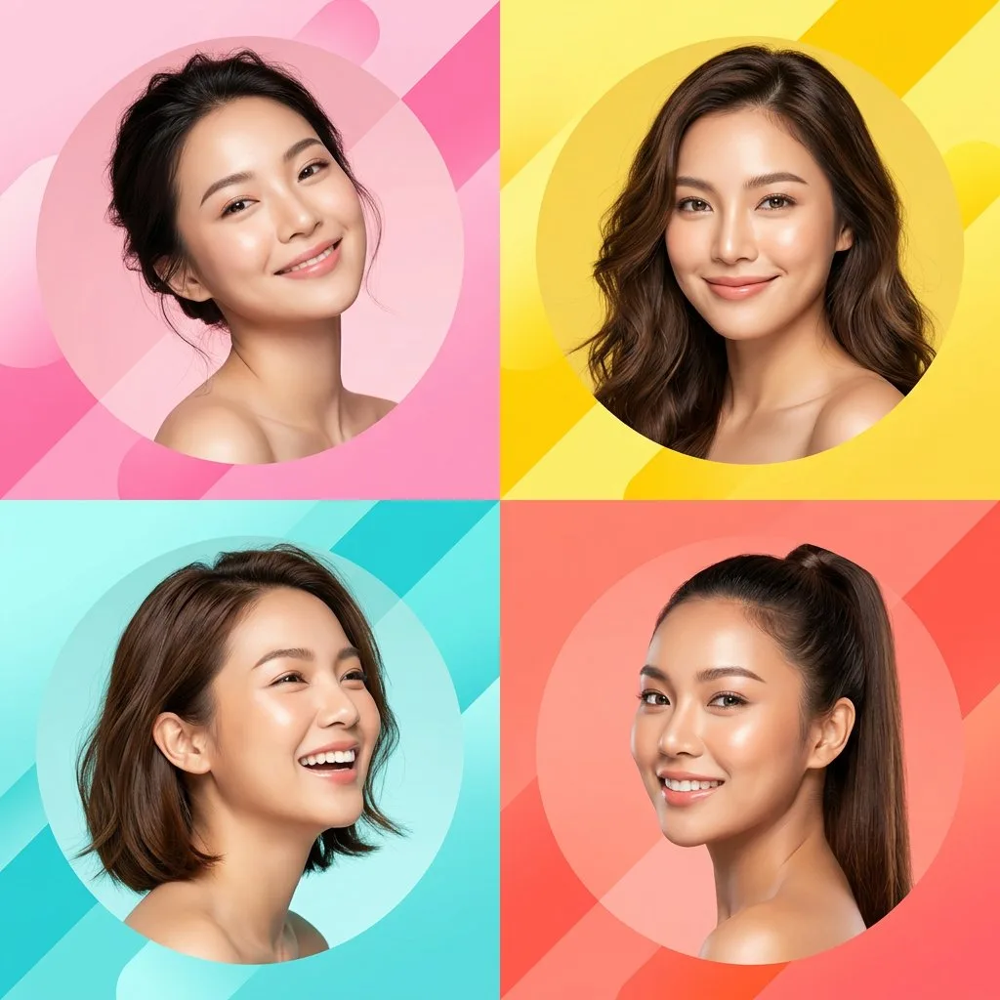

# Cherry 2.O — by @Mind_Boticni

[← Back to Community Examples](../../EXAMPLES.md) · Category: UI & Graphic · Model: `GPT Image`

<a href="https://x.com/Mind_Boticni/status/2047550158427259188"></a>

Source: **[@Mind_Boticni on X](https://x.com/Mind_Boticni/status/2047550158427259188)** · Creator: [Cherry 2.O](https://x.com/Mind_Boticni)

## Prompt

```text
Ultra-modern high-end skincare advertising collage featuring four beautiful young Asian women, each portrait styled in a separate geometric section of a dynamic diagonal layout. Clean editorial beauty photography with soft natural skin texture, glowing healthy complexion, and subtle makeup. Bright vibrant color blocking design using pink, yellow, cyan, and coral tones. Minimal abstract background shapes, smooth gradients, and modern graphic design composition. Studio-quality lighting, fashion magazine aesthetic, premium cosmetic campaign feel. Each woman posed confidently in different angles, smiling softly, fresh and youthful vibe. Balanced symmetry with sharp diagonal divisions and circular portrait frames. Highly polished commercial beauty branding style, cinematic lighting, ultra-detailed, 4k resolution.

IMPORTANT NEGATIVE PROMPT:
No text, no typography, no logos, no brand names, no product bottles, no packaging, no watermark, no labels, no written elements.
```

## Try it

Paste the prompt into **[vinano.ai](https://vinano.ai?utm_source=github&utm_medium=readme&utm_campaign=awesome-image-video-prompts-updating&utm_content=x-page-try)** to generate your own version.

> The image and prompt belong to @Mind_Boticni ([original post](https://x.com/Mind_Boticni/status/2047550158427259188)) and are shown here with credit for reference. Creators can ask for changes or removal by opening an issue.
