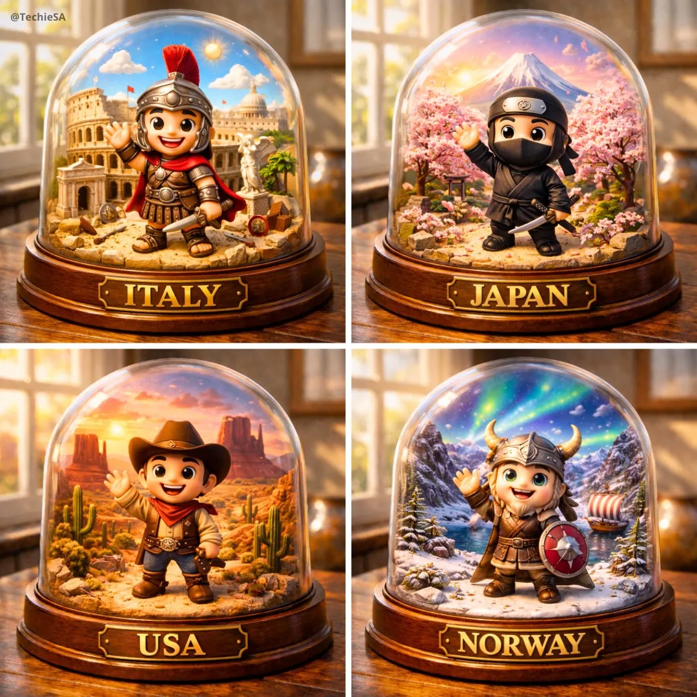

# TechieSA — by @TechieBySA

[← Back to Examples from X](../../EXAMPLES.md) · Category: Illustration & 3D · Model: `GPT Image`

<a href="https://x.com/TechieBySA/status/2009335963672301968"></a>

Original post: **[@TechieBySA on X](https://x.com/TechieBySA/status/2009335963672301968)** · Creator: [TechieSA](https://x.com/TechieBySA)

## Prompt

```text
Create a highly detailed, hyper-realistic image of a miniature diorama inside a glass dome, placed on a wooden table near a softly lit window. Inside the dome, show a [COUNTRY] cultural figure with iconic attire, prominently positioned in the center foreground taking up significant space in the composition to really “pop” from the scene, smiling and waving, in a stylized 3D miniature version of [COUNTRY]’s iconic setting. Include the most iconic background features of that location, all scaled in a whimsical, miniature style. The time of day, season, and mood will vary by [COUNTRY]’s cultural theme. The scene is captured from a slightly elevated perspective. The base of the dome has a wooden plaque with bold, gold-colored text labeled: ‘[COUNTRY]’ in a strong, readable font that stands out prominently. The scene should be bright, magical, joyful, and feel like a collectible souvenir moment from a dream trip. Aspect ratio: 1080x1080
```

## Try it

Paste the prompt into **[vinano.ai](https://vinano.ai?utm_source=github&utm_medium=readme&utm_campaign=awesome-image-video-prompts-updating&utm_content=x-page-try)** to generate your own version.

> The image and prompt belong to [@TechieBySA](https://x.com/TechieBySA) and are shown here with credit for reference. Creators can ask for changes or removal by opening an issue.
