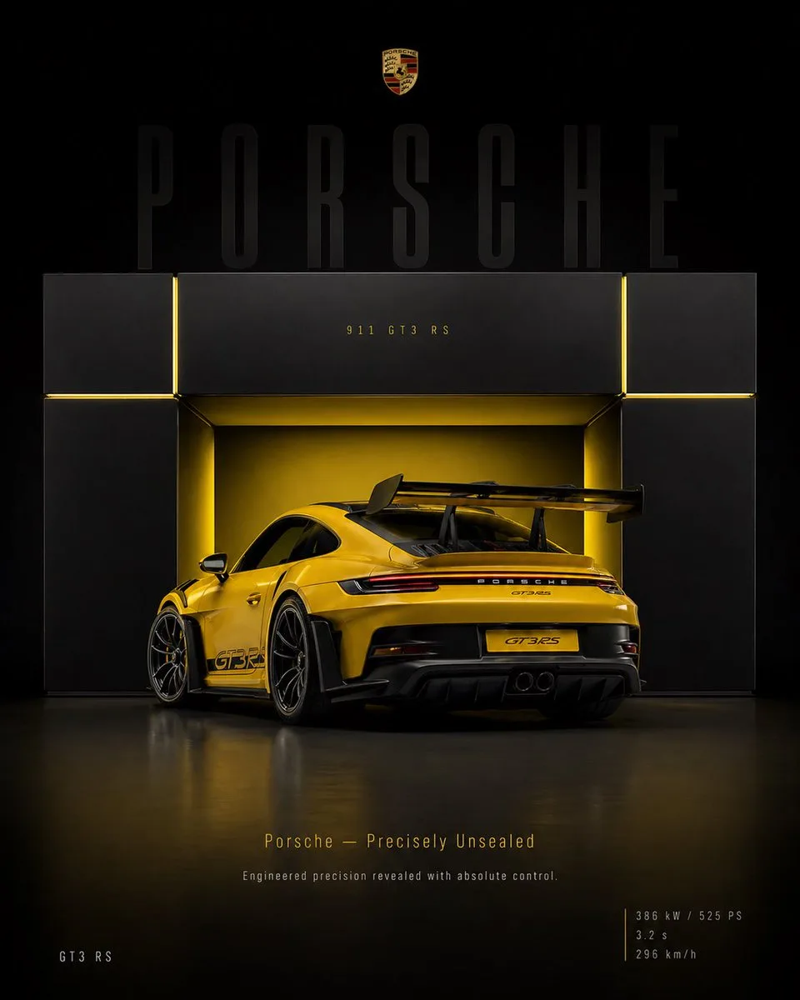

# ᴍᴜʀᴘʜʏ — by @Diplomeme

[← Back to Community Examples](../../EXAMPLES.md) · Category: Poster Design · Model: `GPT Image`

<a href="https://x.com/Diplomeme/status/2048765001817805295"></a>

Source: **[@Diplomeme on X](https://x.com/Diplomeme/status/2048765001817805295)** · Creator: [ᴍᴜʀᴘʜʏ](https://x.com/Diplomeme)

## Prompt

```text
FORMAT:
4:5 vertical poster, ultra high resolution, 8K, ultra-premium automotive campaign, minimal cinematic realism

CORE CONCEPT:
“CONTROLLED UNSEALING”

A precision-engineered object revealed with intent.
Nothing breaks.
Everything separates perfectly.

ENVIRONMENT:

Deep matte black studio

Background:
- almost pure black
- soft, controlled yellow glow diffused behind subject
- no visible light source

Surface:
- ultra clean dark floor
- very soft reflection (5–8%)
- no scratches, no noise

Air:
- almost clean (NO visible dust)

HERO STRUCTURE:

A **precision-engineered display case** — not industrial, not damaged.

Design language:
- monolithic black form
- seamless panels
- razor-sharp edges
- minimal visible joints

Opening behavior:
- panels slide apart with mechanical precision
- no tearing, no debris
- perfect separation lines
- slight offset gaps emitting soft yellow light

Interior:
- Porsche yellow inner chamber
- smooth, matte-satin finish
- soft controlled glow (not bright)

PRODUCT:
[Porsche 911 GT3 RS](chatgpt://generic-entity?number=0)

Angle:
Rear 3/4, slightly low

Position:
Centered, emerging forward subtly

Stance:
- perfectly planted
- minimal steering angle (almost straight)
- composed, not aggressive

DETAILING:

Surface:
- ultra refined gloss
- clean, sharp reflections
- no exaggerated highlights

Carbon:
- visible but subtle
- premium, not loud

Tires:
- clean satin finish
- realistic, not shiny

Integration:
- faint yellow light wrap from interior
- soft contact shadow
- barely visible reflection

COMPOSITION:

Top:
small Porsche crest

Center:
car framed by opening panels

Typography:
secondary to structure

Bottom:
clean editorial + specs

Negative space:
dominant and intentional

TYPOGRAPHY:

PRIMARY:
“PORSCHE”

Style:
Ultra condensed

Treatment:
- subtly embedded into background
- low contrast (dark graphite on black)
- almost discovered, not announced

SECONDARY:
“911 GT3 RS”
thin, technical

EDITORIAL BLOCK:

Headline:
“Porsche — Precisely Unsealed”

Body:
Engineered precision revealed with absolute control.

Minimal copy. No storytelling overload.

SPECS:

386 kW / 525 PS  
3.2 s  
296 km/h  

Clean, technical alignment

LIGHTING:

- soft internal yellow glow (primary)
- controlled top light (soft, even)
- subtle rim separation
- NO harsh contrast spikes

Focus:
surface quality > drama

COLOR GRADING:

- deep neutral blacks
- controlled Porsche yellow
- low saturation outside focal area
- ultra clean finish

CAMERA:

50mm  
eye-level to slightly low  
no distortion  

MOOD:

Calm.
Precise.
Obsessive.

Power under control.
```

## Try it

Paste the prompt into **[vinano.ai](https://vinano.ai?utm_source=github&utm_medium=readme&utm_campaign=awesome-image-video-prompts-updating&utm_content=x-page-try)** to generate your own version.

> The image and prompt belong to @Diplomeme ([original post](https://x.com/Diplomeme/status/2048765001817805295)) and are shown here with credit for reference. Creators can ask for changes or removal by opening an issue.
