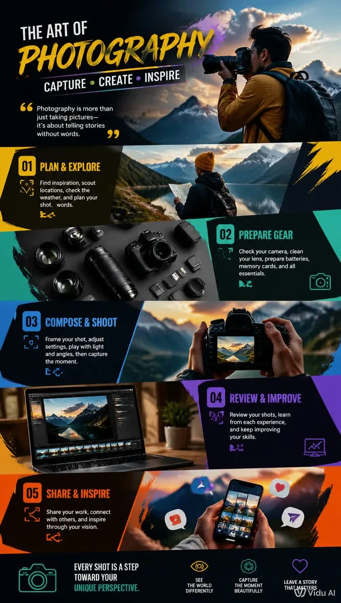

# simeon-sanai — by @Naiknelofar788

[← Back to Community Examples](../../EXAMPLES.md) · Category: UI & Graphic · Model: `GPT Image`

<a href="https://x.com/Naiknelofar788/status/2048746995465203876"></a>

Source: **[@Naiknelofar788 on X](https://x.com/Naiknelofar788/status/2048746995465203876)** · Creator: [simeon-sanai](https://x.com/Naiknelofar788)

## Prompt

```text
Make a portrait-sized wallpaper about several activities from the hobby of (Name Hobby), in the wallpaper it contains various movements in the hobby activity, make the wallpaper design as if it was designed by a professional graphic designer, the coloring and UI of the wallpaper are colorful and don't look commonplace, don't be monotonous, and don't look stiff from the visual of the wallpaper, arranged neatly and precisely, 8k resolution
```

## Try it

Paste the prompt into **[vinano.ai](https://vinano.ai?utm_source=github&utm_medium=readme&utm_campaign=awesome-image-video-prompts-updating&utm_content=x-page-try)** to generate your own version.

> The image and prompt belong to @Naiknelofar788 ([original post](https://x.com/Naiknelofar788/status/2048746995465203876)) and are shown here with credit for reference. Creators can ask for changes or removal by opening an issue.
