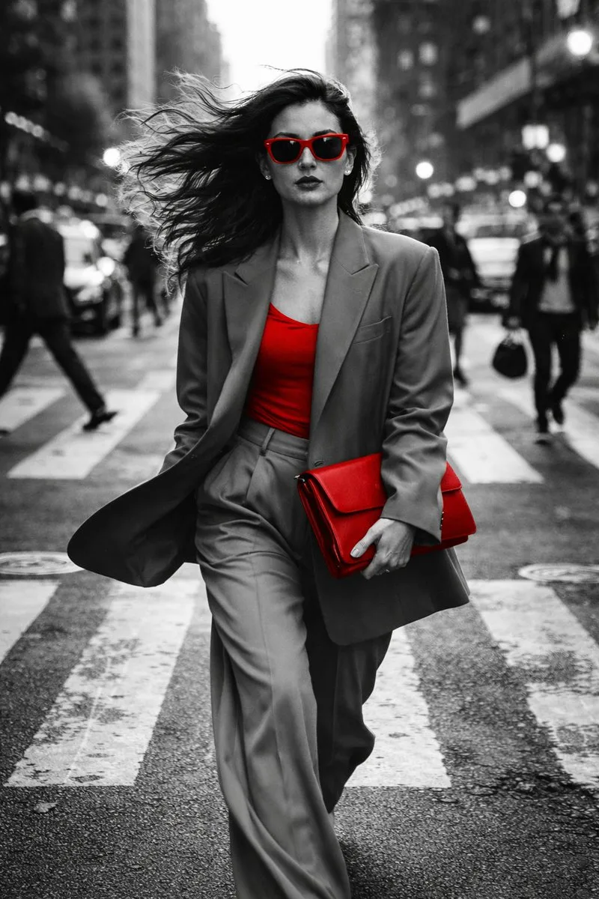

# ShaHid WaNii — by @meng_dagg695

[← Back to Examples from X](../../EXAMPLES.md) · Category: Photography · Model: `GPT Image`

<a href="https://x.com/meng_dagg695/status/2003075417305928072"></a>

Original post: **[@meng_dagg695 on X](https://x.com/meng_dagg695/status/2003075417305928072)** · Creator: [ShaHid WaNii](https://x.com/meng_dagg695)

## Prompt

```text
{
  "objective": "Generate a hyper-realistic black and white street fashion photograph with selective color accents.",
  "image_type": "photography",
  "prompt": {
    "subject": "A stylish, confident woman crossing a busy city intersection",
    "wardrobe": {
      "outerwear": "Oversized blazer in neutral tone",
      "innerwear": "Bright red fitted top (selective color)",
      "bottoms": "Loose tailored trousers in neutral tone",
      "accessories": [
        "Bright red leather clutch in hand",
        "Bright red sunglasses"
      ]
    },
    "action_motion": "Walking briskly toward the camera, hair flowing backward due to motion, blazer and trousers moving naturally",
    "scene": "Busy urban crosswalk with pedestrians and cars motion-blurred in the background",
    "perspective": "Frontal tracking shot at waist level",
    "style": [
      "High-end street fashion",
      "Paparazzi aesthetic",
      "Editorial candid",
      "Dynamic movement photography"
    ],
    "visual_details": [
      "Realistic fabric physics",
      "Detailed hair movement",
      "Sharp facial features",
      "Asphalt road texture",
      "Motion blur on background crowd",
      "Bokeh city lights"
    ],
    "mood": [
      "Confident",
      "Cosmopolitan",
      "Urgent",
      "Powerful"
    ]
  },
  "camera_and_composition": {
    "angle": "Waist-level",
    "framing": "Subject centered, background expanding outward with motion blur",
    "depth_of_field": "Shallow depth of field isolating the subject"
  },
  "lighting": {
    "type": "Natural backlight with rim lighting",
    "contrast": "High contrast emphasizing silhouette and edges"
  },
  "post_processing": {
    "color_mode": "Black and white with selective red color accents only on innerwear, sunglasses, and clutch bag",
    "effects": [
      "Subtle lens flare",
      "Vintage film stock emulation",
      "High micro-contrast",
      "Film grain texture"
    ]
  },
  "negative_prompt": [
    "Posed studio look",
    "Empty street",
    "Static posture",
    "Low realism",
    "Full color image",
    "Overexposed highlights",
    "Flat lighting"
  ],
  "output_quality": {
    "resolution": "Ultra high resolution",
    "detail_level": "Maximum photorealism",
    "sharpness": "Crisp subject, soft background"
  }
}
```

## Try it

Paste the prompt into **[vinano.ai](https://vinano.ai?utm_source=github&utm_medium=readme&utm_campaign=awesome-image-video-prompts-updating&utm_content=x-page-try)** to generate your own version.

> The image and prompt belong to [@meng_dagg695](https://x.com/meng_dagg695) and are shown here with credit for reference. Creators can ask for changes or removal by opening an issue.
