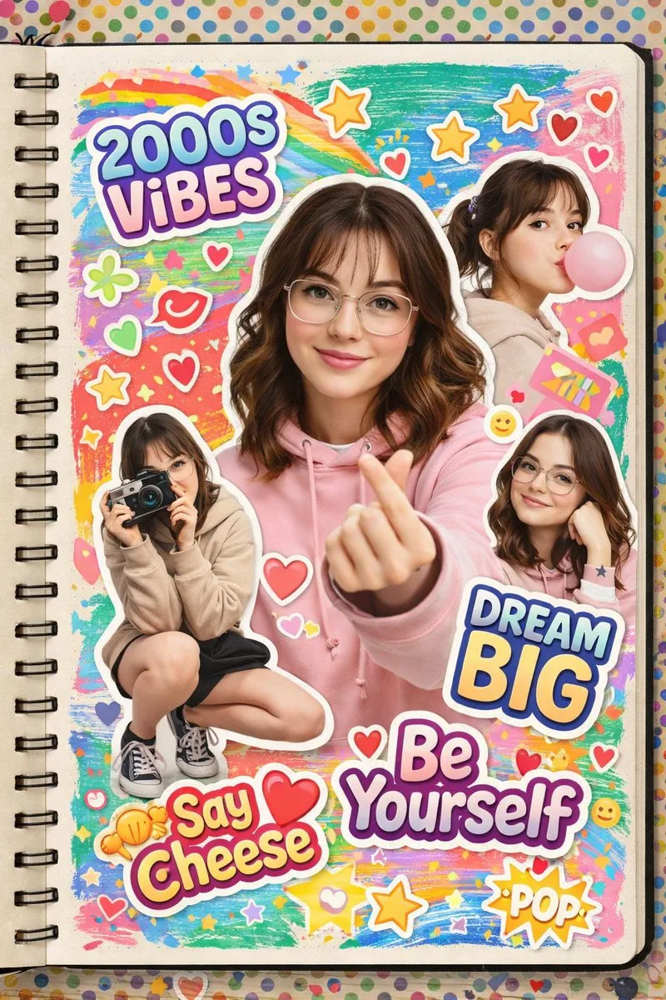

# simeon-sanai — by @Naiknelofar788

[← Back to Community Examples](../../EXAMPLES.md) · Category: Poster Design · Model: `GPT Image`

<a href="https://x.com/Naiknelofar788/status/2012542946848174323"></a>

Source: **[@Naiknelofar788 on X](https://x.com/Naiknelofar788/status/2012542946848174323)** · Creator: [simeon-sanai](https://x.com/Naiknelofar788)

## Prompt

```text
A vibrant 2000s scrapbook-style collage featuring the same young woman in multiple cutout poses. One portrait is centered and large, showing her wearing round glasses and a beige hoodie, making a finger-heart gesture toward the camera. Other cutouts show her squatting with a vintage instant camera, and another blowing a pink bubblegum bubble.

The background looks like an open sketchbook with textured paper, filled with colorful paint strokes in rainbow tones, playful doodles, arrows, stars, hearts, butterflies, smiley faces, and pop-art stickers. Bold, bubbly typography stickers read phrases like “2000s Vibes,” “Dream Big,” “Be Yourself,” “Cool Dude,” “Say Cheese,” and “Pop!”

The overall aesthetic is nostalgic, cheerful, and youthful — inspired by early 2000s teen magazines and scrapbook journals. High saturation, soft lighting, clean white sticker outlines around each cutout, whimsical and fun mood, creative flat-lay composition, digital collage illustration style.
```

## Try it

Paste the prompt into **[vinano.ai](https://vinano.ai?utm_source=github&utm_medium=readme&utm_campaign=awesome-image-video-prompts-updating&utm_content=x-page-try)** to generate your own version.

> The image and prompt belong to @Naiknelofar788 ([original post](https://x.com/Naiknelofar788/status/2012542946848174323)) and are shown here with credit for reference. Creators can ask for changes or removal by opening an issue.
