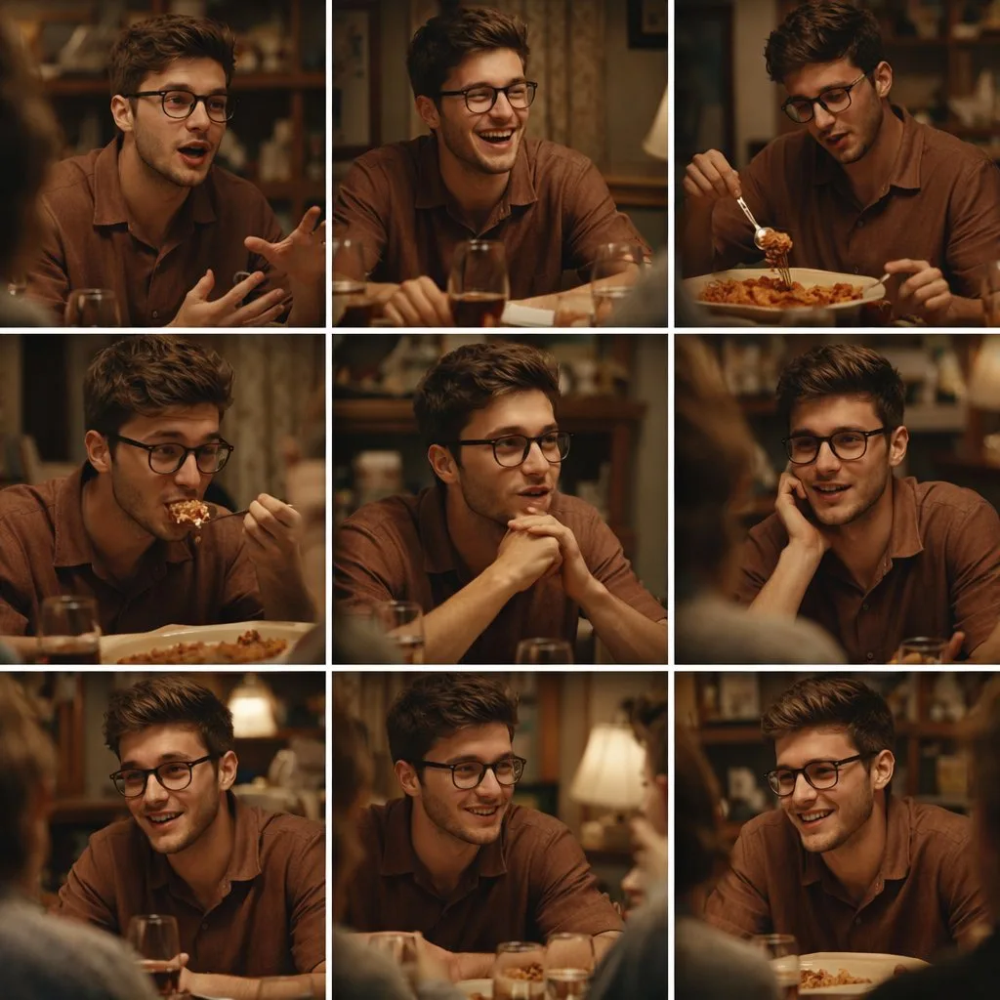

# Oogie — by @oggii_0

[← Back to Examples from X](../../EXAMPLES.md) · Category: Photography · Model: `GPT Image`

<a href="https://x.com/oggii_0/status/2001975468577403099"></a>

Original post: **[@oggii_0 on X](https://x.com/oggii_0/status/2001975468577403099)** · Creator: [Oogie](https://x.com/oggii_0)

## Prompt

```text
A 3x3 grid storyboard contact sheet comprised of nine candid, cinematic movie stills showing a continuous sequence of a young man, approximately 20-25 years old. He has tousled brown hair and a youthful, expressive face, clean-shaven. Across all nine panels, he is consistently wearing a brown short-sleeved linen button-down shirt and is seated at a wooden dining table during a family dinner. The panels show varied natural actions: gesturing with his hands while animatedly talking, laughing, eating lasagna from a large dish, listening intently, and smiling. The environment is a warm, cozy home dining room with a wooden hutch filled with china and patterned wallpaper visible in the background. The lighting is soft, warm tungsten evening light creating natural shadows. The shots are a mix of medium angles and close-ups with a shallow depth of field, rendered with a film photography aesthetic and slight grain.
```

## Try it

Paste the prompt into **[vinano.ai](https://vinano.ai?utm_source=github&utm_medium=readme&utm_campaign=awesome-image-video-prompts-updating&utm_content=x-page-try)** to generate your own version.

> The image and prompt belong to [@oggii_0](https://x.com/oggii_0) and are shown here with credit for reference. Creators can ask for changes or removal by opening an issue.
