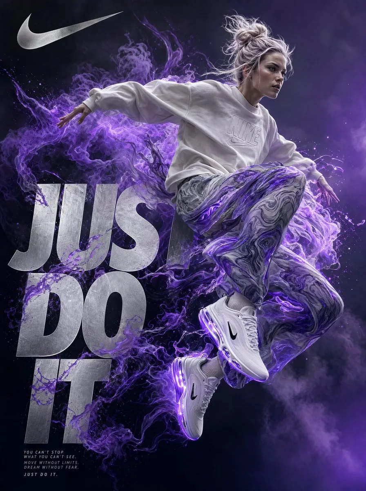

# Heisenberg — by @rovvmut_

[← Back to Community Examples](../../EXAMPLES.md) · Category: Poster Design · Model: `GPT Image`

<a href="https://x.com/rovvmut_/status/2047721704202617219"></a>

Source: **[@rovvmut_ on X](https://x.com/rovvmut_/status/2047721704202617219)** · Creator: [Heisenberg](https://x.com/rovvmut_)

## Prompt

```text
A highly detailed digital artwork in a surreal, dynamic style inspired by premium athletic advertising for Nike, Inc. A young athletic woman with platinum blonde hair tied in a messy bun, fair skin, and a fiercely focused expression is captured mid-jump or leap, her body leaning slightly forward as if bursting with raw, untamed energy.
She wears a loose, off-white Nike crewneck sweatshirt with subtle embossed Nike branding on the chest, paired with flowy, semi-transparent pants featuring a swirling marbled pattern in graphite grey and electric violet, billowing dramatically around her legs. On her feet are sleek, futuristic white Nike sneakers with glowing violet accents, visible Air-inspired sole details, and an aerodynamic design.
Vibrant electric violet energy or ethereal smoke erupts dramatically from behind her, swirling and dissolving into abstract, cloud-like forms that interact with her clothing, creating a powerful sense of motion and release.
The background is a deep, moody gradient transitioning from charcoal grey to luminous twilight violet, emphasizing a minimalist yet striking composition.
Overlay large, bold metallic silver text reading “Just Do It” in a sharp, modern sans-serif font, partially integrated and obscured by the energy smoke and the figure, making it feel like an organic part of the scene.
Include the iconic Nike Swoosh logo in the top-left corner in shimmering silver.
```

## Try it

Paste the prompt into **[vinano.ai](https://vinano.ai?utm_source=github&utm_medium=readme&utm_campaign=awesome-image-video-prompts-updating&utm_content=x-page-try)** to generate your own version.

> The image and prompt belong to @rovvmut_ ([original post](https://x.com/rovvmut_/status/2047721704202617219)) and are shown here with credit for reference. Creators can ask for changes or removal by opening an issue.
