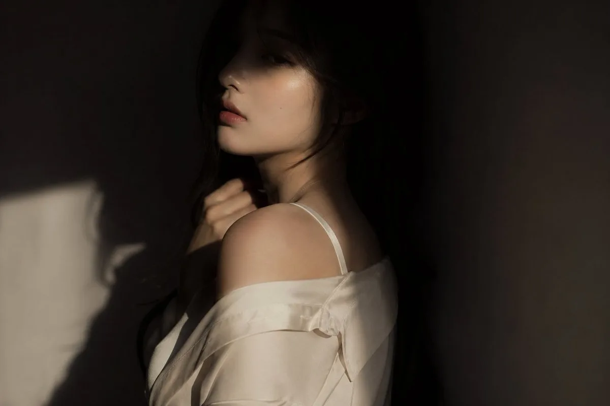

# BubbleBrain — by @BubbleBrain

[← Back to Examples from X](../../EXAMPLES.md) · Category: Photography · Model: `GPT Image`

<a href="https://x.com/BubbleBrain/status/2048600232577933720"></a>

Original post: **[@BubbleBrain on X](https://x.com/BubbleBrain/status/2048600232577933720)** · Creator: [BubbleBrain](https://x.com/BubbleBrain)

## Prompt

```text
editorial portrait, Korean female idol, subtly sensual  outfit: silk shirt or soft fabric top, slightly loose, elegant and flowing  pose: body slightly turned away, face partially visible, one hand near collar or neck  expression: soft but unreadable, eyes partially hidden  lighting: strong directional light (window light), casting shadows across face and body  background: dark or minimal interior  composition: partial visibility, half-lit face, shadow covering features  mood: mysterious, intimate, quiet tension  style: cinematic editorial, light and shadow storytelling  sensuality: created through concealment and ambiguity --3:2
```

## Try it

Paste the prompt into **[vinano.ai](https://vinano.ai?utm_source=github&utm_medium=readme&utm_campaign=awesome-image-video-prompts-updating&utm_content=x-page-try)** to generate your own version.

> The image and prompt belong to [@BubbleBrain](https://x.com/BubbleBrain) and are shown here with credit for reference. Creators can ask for changes or removal by opening an issue.
