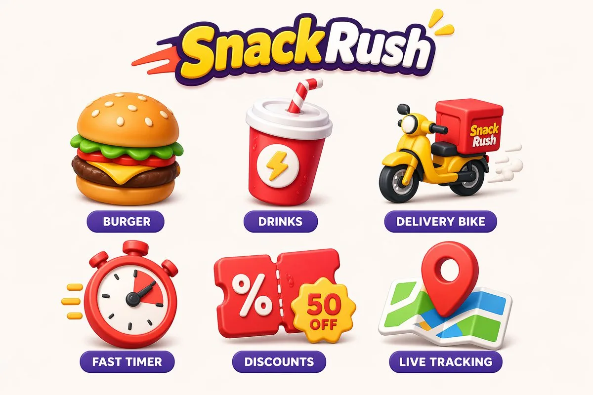

# Aleena Amir — by @aleenaamiir

[← Back to Examples from X](../../EXAMPLES.md) · Category: UI & Graphic · Model: `GPT Image`

<a href="https://x.com/aleenaamiir/status/2047546614257221653"></a>

Original post: **[@aleenaamiir on X](https://x.com/aleenaamiir/status/2047546614257221653)** · Creator: [Aleena Amir](https://x.com/aleenaamiir)

## Prompt

```text
Create a cohesive collection of playful icons for [BRAND NAME], a [BRAND TYPE/INDUSTRY] brand. Style should be [STYLE KEYWORDS: e.g., rounded, 3D, flat, hand-drawn, minimal] with a [COLOR STYLE: vibrant, pastel, gradient, monochrome] palette. Use [DESIGN TRAITS: soft shadows, bold outlines, subtle textures, glow, etc.] to give a friendly and modern feel. Maintain consistency across all icons with a unified grid, proportions, and visual language. Icons should represent [LIST OF FEATURES/FUNCTIONS]. Ensure high clarity, balanced spacing, and scalable design suitable for UI, apps, and branding.
```

## Try it

Paste the prompt into **[vinano.ai](https://vinano.ai?utm_source=github&utm_medium=readme&utm_campaign=awesome-image-video-prompts-updating&utm_content=x-page-try)** to generate your own version.

> The image and prompt belong to [@aleenaamiir](https://x.com/aleenaamiir) and are shown here with credit for reference. Creators can ask for changes or removal by opening an issue.
