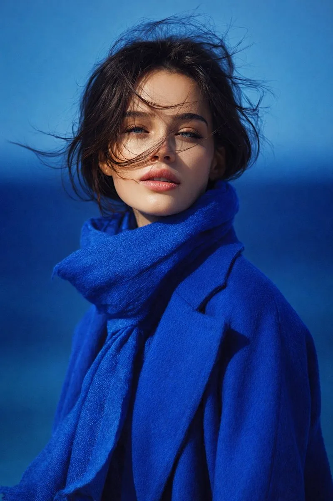

# ShaHid WaNii — by @meng_dagg695

[← Back to Examples from X](../../EXAMPLES.md) · Category: Photography · Model: `GPT Image`

<a href="https://x.com/meng_dagg695/status/2005107364203298875"></a>

Original post: **[@meng_dagg695 on X](https://x.com/meng_dagg695/status/2005107364203298875)** · Creator: [ShaHid WaNii](https://x.com/meng_dagg695)

## Prompt

```text
{
  "image_type": "portrait_photography",
  "resolution_target": "8K UHD",
  "aspect_ratio": "vertical",
  "frame_composition": {
    "crop": "mid-chest to head",
    "orientation": "portrait",
    "subject_position": "centered",
    "camera_angle": "eye-level",
    "perspective": "straight-on"
  },
  "subject": {
    "gender_presentation": "female",
    "age_appearance": "young adult",
    "face": {
      "shape": "oval",
      "skin_tone": "fair with neutral undertone",
      "skin_texture": "smooth, natural, visible realism, no heavy retouching",
      "facial_features": {
        "eyes": {
          "color": "light blue-green",
          "shape": "almond-shaped",
          "gaze_direction": "directly toward camera",
          "eyelids": "slightly relaxed",
          "eyelashes": "natural length, not exaggerated"
        },
        "eyebrows": {
          "color": "dark brown",
          "thickness": "medium",
          "shape": "soft natural arch"
        },
        "nose": {
          "shape": "straight",
          "size": "proportionate",
          "bridge": "smooth"
        },
        "lips": {
          "color": "soft natural pink",
          "fullness": "medium to full",
          "state": "slightly parted"
        }
      },
      "expression": "neutral, calm, composed"
    },
    "hair": {
      "color": "dark brown",
      "length": "short to medium",
      "style": "loose, slightly wavy",
      "movement": "wind-blown strands crossing face",
      "parting": "natural, unstructured"
    }
  },
  "clothing": {
    "outerwear": {
      "type": "coat",
      "color": "deep royal blue",
      "material_appearance": "wool or felt-like texture",
      "fit": "structured but relaxed",
      "visible_details": "clean seams, minimal design"
    },
    "accessory": {
      "type": "scarf",
      "color": "matching royal blue",
      "material_appearance": "soft, fabric texture",
      "placement": "wrapped loosely around neck"
    }
  },
  "color_palette": {
    "dominant_colors": [
      "royal blue",
      "deep blue",
      "soft skin tones"
    ],
    "contrast": "high contrast between blue clothing and lighter skin",
    "color_temperature": "cool"
  },
  "lighting": {
    "type": "natural light",
    "direction": "frontal with slight side softness",
    "intensity": "moderate",
    "shadows": "soft, minimal harsh shadows",
    "highlights": "subtle highlights on cheekbones and lips"
  },
  "background": {
    "environment": "open outdoor setting",
    "elements": "blurred horizon line, blue gradient background",
    "depth_of_field": "shallow",
    "background_detail": "intentionally out of focus",
    "color": "blue gradient resembling sky and distant water"
  },
  "image_style": {
    "realism": "high realism with subtle AI polish",
    "sharpness": "high facial detail",
    "texture_detail": "visible fabric texture and skin detail",
    "noise": "minimal",
    "post_processing": "clean color grading, no heavy filters"
  },
  "mood": {
    "overall_feel": "calm, serene, minimalistic",
    "visual_energy": "soft and composed"
  },
  "generation_constraints": {
    "preserve_original_composition": true,
    "preserve_subject_structure": true,
    "no_face_alteration": true,
    "no_style_assumptions": true,
    "do_not_change_image_size": true
  }
}
```

## Try it

Paste the prompt into **[vinano.ai](https://vinano.ai?utm_source=github&utm_medium=readme&utm_campaign=awesome-image-video-prompts-updating&utm_content=x-page-try)** to generate your own version.

> The image and prompt belong to [@meng_dagg695](https://x.com/meng_dagg695) and are shown here with credit for reference. Creators can ask for changes or removal by opening an issue.
