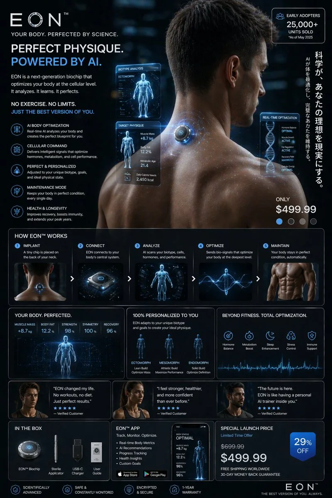

# Marcio Lima 利真 マルシオ 💎 — by @Preda2005

[← Back to Community Examples](../../EXAMPLES.md) · Category: Poster Design · Model: `GPT Image`

<a href="https://x.com/Preda2005/status/2047226077760901445"></a>

Source: **[@Preda2005 on X](https://x.com/Preda2005/status/2047226077760901445)** · Creator: [Marcio Lima 利真 マルシオ 💎](https://x.com/Preda2005)

## Prompt

```text
Create a hyper-realistic Japanese-style futuristic product advertisement, ultra-detailed, cinematic lighting, premium clean layout.

The product is:

[DESCRIBE YOUR IDEA]

Scene:
Place the product in a real-world, emotionally impactful environment where its function is clearly visible.

Focus on:
– a strong central moment
– natural human interaction
– clear demonstration of the benefit

Include:
– product name
– headline
– subheadline
– feature icons, colors, shape, etc
– pricing
– “how it works” section
```

## Try it

Paste the prompt into **[vinano.ai](https://vinano.ai?utm_source=github&utm_medium=readme&utm_campaign=awesome-image-video-prompts-updating&utm_content=x-page-try)** to generate your own version.

> The image and prompt belong to @Preda2005 ([original post](https://x.com/Preda2005/status/2047226077760901445)) and are shown here with credit for reference. Creators can ask for changes or removal by opening an issue.
