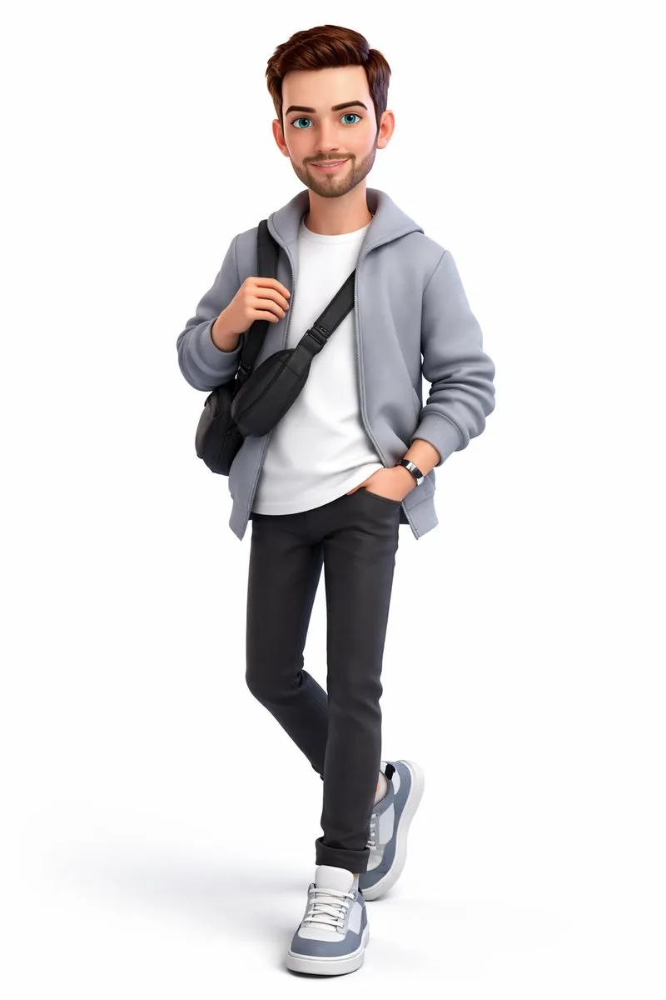

# Johnn — by @john_my07

[← Back to Community Examples](../../EXAMPLES.md) · Category: Illustration & 3D · Model: `GPT Image`

<a href="https://x.com/john_my07/status/2016380202927206785"></a>

Source: **[@john_my07 on X](https://x.com/john_my07/status/2016380202927206785)** · Creator: [Johnn](https://x.com/john_my07)

## Prompt

```text
A full-body 3D stylized cartoon boy, Pixar/Disney-inspired character design, cute and modern look, generated from the provided reference photo. Preserve the subject’s facial structure, proportions, and identity while translating them into a stylized animated form. He has well-groomed short-to-medium hair styled to match the reference, expressive eyes, soft facial features, and a friendly, confident smile.
He is wearing a clean white oversized t-shirt, a high-waisted casual jacket or hoodie (optional), slim-fit pants, and modern sneakers that match the color palette of the outfit. A small crossbody sling bag or backpack adds a trendy touch. Slim proportions, smooth skin, polished 3D render, standing in a relaxed walking or casual pose.
Clean white background, soft studio lighting, high detail, ultra-smooth textures, vibrant yet natural colors, modern fashion doll aesthetic, professional character render, cinematic quality, 4K resolution.
```

## Try it

Paste the prompt into **[vinano.ai](https://vinano.ai?utm_source=github&utm_medium=readme&utm_campaign=awesome-image-video-prompts-updating&utm_content=x-page-try)** to generate your own version.

> The image and prompt belong to @john_my07 ([original post](https://x.com/john_my07/status/2016380202927206785)) and are shown here with credit for reference. Creators can ask for changes or removal by opening an issue.
