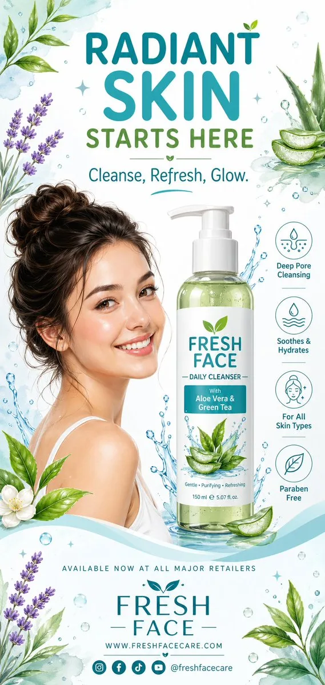

# Ozair AI — by @Ozayrr_irl

[← Back to Examples from X](../../EXAMPLES.md) · Category: Poster Design · Model: `GPT Image`

<a href="https://x.com/Ozayrr_irl/status/2048662802475409637"></a>

Original post: **[@Ozayrr_irl on X](https://x.com/Ozayrr_irl/status/2048662802475409637)** · Creator: [Ozair AI](https://x.com/Ozayrr_irl)

## Prompt

```text
A clean, refreshing vertical advertising poster design for a face wash product, using a graphic illustration style with soft watercolor and vector elements. The poster is set against a clean white and light teal background. The central figure is a beautiful, smiling young woman with natural, glowing, radiant skin and her hair loosely tied back in a messy bun, looking confidently towards the viewer with fresh-faced appearance. She has a touch of natural makeup.
The overall style is clean, modern, and graphic, with flowing organic shapes, stylized leaves, flowers, and water splashes in shades of aqua, teal, light green, and white. The background features delicate, stylized illustrations of botanical ingredients like aloe vera, green tea leaves, and lavender.
At the top, large, friendly, rounded sans-serif font reads: "RADIANT SKIN STARTS HERE". Below this, a catchy tagline: "Cleanse, Refresh, Glow."
The main product, a stylized bottle of face wash with a white pump and green and blue labeling, is illustrated to the right of the woman. The bottle is labeled "FRESH FACE DAILY CLEANSER" and mentions "With Aloe Vera & Green Tea." There are small graphical icons around the bottle with text: "Deep Pore Cleansing", "Soothes & Hydrates", "For All Skin Types", "Paraben Free".
Small illustrative bubbles, stars, and botanical accents float around the composition, adding a sense of lightness and freshness. At the bottom, in a clean, modern font, it says: "AVAILABLE NOW AT ALL MAJOR RETAILERS" followed by a stylized logo "FRESH FACE" and the website "https://t.co/OUIoDMOWF6" and social media icons (freshfacecare). The poster has a clean layout with ample negative space and soft, natural lighting.
```

## Try it

Paste the prompt into **[vinano.ai](https://vinano.ai?utm_source=github&utm_medium=readme&utm_campaign=awesome-image-video-prompts-updating&utm_content=x-page-try)** to generate your own version.

> The image and prompt belong to [@Ozayrr_irl](https://x.com/Ozayrr_irl) and are shown here with credit for reference. Creators can ask for changes or removal by opening an issue.
